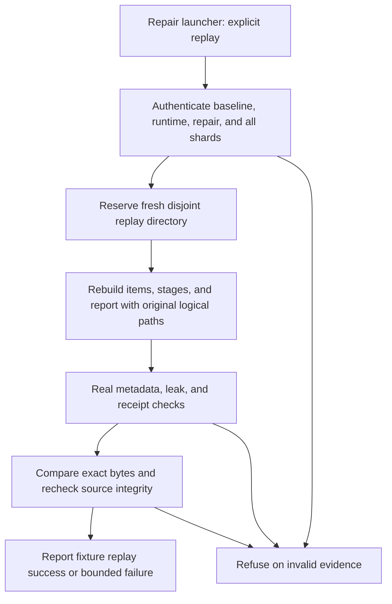

# Complete offline U10 finalization replay - Plan

## Goal Capsule

- **Objective:** An operator can prove, offline, that U10 finalization reproduces an authenticated result and can distinguish that proof from validation of an existing receipt.
- **Means:** Extend the reviewed repair entrypoint with explicit replay verification, exercise the complete path with generated fixtures, and reconcile available U10 history (KTD1–KTD5).
- **Authority:** The controller's `fr-1` mandate scopes this plan to the offline portions of recovery units 3–6. The chief-repo authority is `docs/plans/2026-10-26-0705-feat-codex-drawdown-campaign-plan.md`, Goal Capsule and campaign R11, R15, R16, R17, R19, R20. That file and `ops/drawdown/mandates/_common.md` were unavailable in this sandbox; their exact text was not verified. The supplied standing rules apply here. Repository behavior remains governed by `CLAUDE.md` and the three September 30 plans cited below.
- **Execution boundary:** This artifact is the plan-stage deliverable. The later build uses generated inputs and local commits on `drawdown/fr-1`; the controller supplies missing reference evidence and owns scanning, push, PR creation, and the campaign merge gate.
- **Stop conditions:** Reject missing or inconsistent baseline evidence, changed fingerprints, repair-identity mismatch, leak collisions, unsafe replay destinations, and unequal bytes. Never repair those conditions by weakening a gate or changing preserved evidence.
- **Completion limit:** Offline fixture verification does not establish original-input replay, a measured R17 verdict, R11 adoption eligibility, or live campaign completion.

---

## Product Contract

### Summary

Finish the offline preparation for recovery units 3–6 by adding an explicit, non-mutating replay check to the existing finalization repair path.
The build will also prove that its generated comparison can feed the existing campaign-report renderer and record what local U10 history establishes.
Actual preserved-checkpoint execution and aggregate publication remain controller-owned.

### Problem Frame

A completed U10 invocation currently validates its final receipt and returns before regenerating output.
That return cannot prove the byte-identical replay required by the recovery plan.
Changing the output or checkpoint argument to a scratch path also changes provenance, so an independent replay needs separate physical destinations while retaining the original logical bindings.

### Verified Starting State

Static inspection on 2026-10-26 found a clean `drawdown/fr-1` at `faf9bba5a1969daba0cb021f7de01b14e4bfe3e8`.
Only `drawdown/fr-1` and local `main` (`0a09f2c`) are available; `main` is seven commits behind this branch, and no remote is configured.
This establishes the supplied checkout state, not current `origin/main` or remote branch state.

| Area | Evidence | Consequence for this item |
|---|---|---|
| Narrow v2 repair | `2e9c34f`, merged by `c3a0143`, is already in local history; `FINALIZATION_REPORT_PATHS` contains the existing v2 working output. | Do not reapply the September repair. |
| Separate repair source | `ddf6cc2`; `eval/run_comparison_pilot_repair.py` and `eval/folio_eval/comparison_pilot_repair.py`. | Retain isolated execution and clean, separate candidate/repair identities. |
| Receipt shortcut | `eval/folio_eval/comparison_pilot.py`, `_main` and `_load_final_completion`. | Ordinary repetition validates report/receipt and fingerprint; it does not rebuild or revalidate every source shard. |
| Finalization | `_finalize`, `_finalization_invocation`, `_file_fingerprint`, and `write_stage_snapshots`. | Reads and generated writes currently share checkpoint paths; report provenance includes logical paths. |
| Test coverage | `tests/test_eval_comparison_pilot.py` covers receipts and refusal paths, but its finalize-only test substitutes `_finalize`. | Add real generated-fixture integration before changing the finalizer. |
| Campaign test isolation | `tests/test_eval_campaign_report.py` reads committed corpus files at module import. | A `-k` filter cannot make that module safe for this lane; use a separate generated-fixture module. |
| Historical branches | `a78f8fe` merged `feat/u10-resumable-pilot-final`; the October 20 handoff records other unmerged-by-ancestry tips. | Landed feature ancestry does not prove equivalence of missing branch tips. |
| Live acceptance | `docs/handoffs/2026-10-20-sweep-cloud-folio-resolve.md` still records original-input replay as pending. | Historical test counts and receipt counts are not fresh acceptance evidence. |

No tests, provider runs, or protected-input inspections were performed during planning.

### Requirements

Requirement IDs below are local to this plan. References prefixed **campaign** identify the chief-repo campaign; **evaluation R17** and **retrieval R11** identify existing repository adoption gates.

**Finalization and replay**

- R1. Existing finalize-only behavior remains available through the isolated repair launcher, with its candidate/runtime/metadata bindings and no shard or incumbent preparation in that mode.
- R2. Explicit replay requires an authenticated baseline report and final completion receipt, then independently regenerates the report, final items, every expected stage file, and equivalent final receipt bytes before claiming equality.
- R3. Replay preserves the source checkpoint and baseline artifacts byte-for-byte on success, mismatch, interruption, and refusal; missing or drifting evidence fails closed.
- R4. Generated output retains the original logical invocation and artifact paths, candidate identity, repair identity, metadata policy, serializer, and leak checks; no post-serialization normalization may hide differences.

**Offline scope and policy**

- R5. Lane execution uses generated fixtures only and stops before any provider call, consumer scoring, model download, or protected evaluation-input read. The build adds tests without deleting or weakening existing tests (campaign R11, R15, R16).
- R6. The generated verified comparison feeds existing campaign reporting without changing evaluation R17, retrieval R11, firm-exam ownership, or the U6/KTD12 stop-rule ruling.
- R7. Branch reconciliation identifies contained, equivalent, unique, and unavailable U10 history without deleting refs, rewriting history, changing the measured candidate, or obtaining a remote/login (campaign R17, R19).
- R8. Public evidence records fixture proof and controller dependencies separately; it contains no original corpus text, item identifiers, salts, credential material, checkpoint digests, machine-local paths, or unverified live-completion claims.
- R9. Delivery remains one planned item on `drawdown/fr-1`, with retained review evidence and controller-owned publication; unavailable controller material does not create a new Damien decision (campaign R15, R17, R19, R20).

### Acceptance Examples

- AE1. **Covers R1–R4.** Given generated completed shards and a first valid finalization, ordinary repetition returns without rebuilding; explicit replay executes the shared artifact builder and proves exact equality in a fresh destination.
- AE2. **Covers R2–R4.** Given a valid first receipt but a changed shard, missing stage file, changed runtime, or different repair identity, replay refuses and leaves the baseline unchanged.
- AE3. **Covers R2–R5.** Given an injected difference in regenerated items, stages, or report bytes, replay fails even when parsed metrics match, and no provider or shard execution occurs.
- AE4. **Covers R5, R6, R8.** Given a generated replay-verified comparison, campaign reporting renders deterministically under its real validators; the result is labeled fixture evidence and changes no live verdict or reminder.
- AE5. **Covers R7, R9.** Given missing historical branch tips, the reconciliation receipt marks them unavailable and lists the evidence the controller must supply; it does not mark them merged or delete them.

### Scope Boundaries

The active scope is recovery units 3–6's code, fixture proof, replay instructions, and non-destructive local history reconciliation.
Recovery units 1–2's already-landed repair is a starting point.
The original recovery plan remains authoritative for preserved-input execution; this plan does not replace it.

Excluded: live/provider measurement, original checkpoint execution in this lane, protected-input reads or rewrites, salt/manifest changes, fingerprint rebinding, stop-rule changes, frozen firm exam, actual adoption decisions, consumer application edits, board writes, package releases, schema migrations, new services, spend, credential/security changes, sends, force-push, or deletion of unbacked data.
There is no front-end change.

Considered and not built: a generalized checkpoint backup/restore framework, automatic retry/cleanup, broad output-path exemptions, a separate replay serializer, and production report-policy changes.
The existing validators plus a verification-only mode cover this item's failure paths; another recovery mechanism needs evidence beyond the current replay gap.

Deferred to other mandate items: `fr-2` campaign readiness summary, `fr-3` consumer scorecards, and `fr-4` persona UAT/dependency/worktree hygiene.

---

## Planning Contract

**Product Contract preservation:** The September 30 recovery and adoption contracts remain unchanged; this plan scopes their offline preparation and labels the controller-owned remainder.

### Key Technical Decisions

- KTD1. **Use the existing isolated repair entrypoint.** Add an opt-in `--verify-replay-dir` argument consumed by repair orchestration; it requires `--finalize-only` and an already finalized baseline. Ordinary invocation retains its receipt-validation shortcut. This avoids duplicating the launcher safeguards. Governs R1–R3.
- KTD2. **Separate artifact construction from publication destinations.** Extract the smallest shared finalization assembly path from `_finalize`. Source checkpoint reads and logical provenance stay bound to the original arguments; only physical replay writes use the fresh staging directory. Hash newly generated items/stages, then attach their original logical paths before serialization. Do not copy expected output fields into the regenerated payload. Governs R2, R4.
- KTD3. **Authenticate before comparing.** Validate the original manifest, every selected completed shard, baseline report/receipt, referenced generated-file digests/sizes, and the current clean repair identity before creating replay output. Recheck fingerprint and baseline/source integrity before success. Require the same reviewed repair identity for first finalization and replay; never attribute new execution to older code. Governs R2–R4.
- KTD4. **Keep proof isolated from protected data.** Put new integration tests in `tests/test_eval_u10_finalize_replay.py`, with generated corpus/config/metadata/leak manifest/salt and receipt fixtures. Substitute only unavailable runtime/consumer seams and fixture path/pin inputs; retain the real receipt loaders, finalizer, serializer, metadata checks, leak scanner, and campaign validators. Governs R5, R6.
- KTD5. **Reconcile by evidence, not branch names.** Record exact available tips and ancestry, then compare equivalent patches and remaining diffs where both tips exist. Integrate only missing work required by R1–R6. Missing refs stay unavailable until the controller supplies local history; no remote discovery is part of this branch. Governs R7.
- KTD6. **Keep the campaign's model and delivery choices.** Use Astra for build/review work (session-settled: user-directed — chosen over the Sol-first ladder). Complete the independent offline work without waiting on Damien (session-settled: user-directed — chosen over holding work for review through 2026-10-30). Existing campaign publication guardrails apply; this item adds no expansion or speculative feature. Governs R9.

### Replay State and Data Flow

| Baseline state | Ordinary finalize-only | Explicit replay |
|---|---|---|
| No manifest | Existing refusal | Refuse before mutation |
| Missing/incomplete shard receipts and no final receipt | Existing finalization rejects invalid shards | Refuse before mutation |
| Valid complete shards; no final report/receipt | Existing first finalization | Refuse: first finalization required |
| Report exists; final receipt absent | Existing recovery behavior can overwrite the report | Refuse; preserve the orphan report for controller recovery |
| Valid final report and receipt | Existing validation shortcut | Validate every shard and generated artifact, then regenerate |
| Corrupt baseline, identity mismatch, missing generated artifact, or changed fingerprint | Existing applicable checks | Refuse without changing originals |

The report-without-receipt row is an existing limitation, not a new overwrite authorization.
Before any later controller-owned first finalization, inventory existing outputs and verify a backup; preserve an orphan report separately and do not overwrite differing evidence.
This item characterizes that state with fixtures and does not add a generalized recovery mode.

The source checkpoint and baseline are read-only throughout explicit replay.
Failures report artifact categories and gate outcomes, never a JSON diff, restricted match, input identifier, or private path/digest.
The replay directory is fresh, non-symlinked, atomically reserved, and disjoint from inputs, original outputs, and candidate/repair/consumer source or runtime roots.
Partial replay files remain available for inspection; retries require a new destination.
No success evidence is issued until every R2 comparison and R3 preservation check passes.

### Assumptions and Dependencies

- The chief plan's cited sections were not supplied to this clone. The controller must check this plan against its Goal Capsule and cited R-IDs before build dispatch; the supplied standing rules are the current authority available here.
- Original candidate runtime, pinned consumer checkouts, bound inputs, complete checkpoint, and verified backup remain controller-owned prerequisites for actual U10 completion. They are not required to build or run the generated fixtures.
- Historical `eval/u10-*` and `feat/u10-resumable-pilot*` tips are absent. Local reconciliation can proceed, but exhaustive branch reconciliation requires the controller to supply exact local refs or an equivalent history bundle.
- Runtime/model-cache availability and original fingerprint agreement are deliberately unverified. Do not install into, repin, or synchronize the preserved candidate environment to make a replay pass.
- Unix sockets are denied in this sandbox. A socket-dependent test failure must be classified as an environment limitation, never hidden by weakening a test.

### Sources and Research

- `docs/plans/2026-09-30-u10-finalization-recovery-plan.md`, especially units 3–6 and the receipt-versus-regeneration distinction.
- `docs/plans/2026-09-30-retrieval-loss-live-completion-plan.md` and `docs/plans/2026-09-30-downstream-evidence-gated-adoption-plan.md`: separate measurement ownership and unchanged adoption gates.
- `docs/plans/2026-09-06-001-eval-u10-comparison-v2-and-u13-closeout-plan.md`: original replay and close-out requirement; its scratch-path wording needs KTD2's binding distinction.
- `docs/plans/2026-08-16-001-feat-synthetic-benchmark-f1-campaign-plan.md`, KTD12/U9 amendment: no synthetic stop-gate edit.
- `docs/solutions/2026-09-04-u9-iteration-traps.md` and `docs/solutions/2026-09-07-u10-comparison-rerun-traps.md`: pristine checks, optional fingerprint dependencies, candidate identity, and working/publication path distinction.
- `docs/solutions/2026-09-19-synthetic-score-manifest-verification.md`: generated local-gold isolation with real freshness checks.
- `docs/solutions/2026-09-30-frozen-evidence-blocks-library-edits.md`: authenticate expected evidence before replay; its embedding-specific policy does not relax U10 fingerprint rules.
- `docs/handoffs/2026-10-20-sweep-cloud-folio-resolve.md`: last available live-replay limitation and branch observations, treated as historical evidence.

---

## Implementation Units

### U1. Reconcile the supplied U10 source and history

- **Goal:** Establish which required repair work is already present and preserve every unresolved branch delta.
- **Requirements:** R7–R9; recovery unit 3; KTD5, KTD6.
- **Dependencies:** None for local inspection. Controller-supplied branch tips are required only for exhaustive comparison.
- **Files:** Create `docs/plans/evidence/fr-1-u10-reconciliation.md`; inspect `eval/folio_eval/comparison_pilot.py`, `eval/folio_eval/comparison_pilot_repair.py`, `eval/run_comparison_pilot_repair.py`, and their local history.
- **Approach:** Record the starting refs and landed source anchors. Classify available branch deltas using ancestry and patch comparison, including older implementations already superseded by reviewed fixes. List unavailable tips explicitly. Preserve unrelated changes and keep the measured candidate separate from repair source.
- **Patterns to follow:** The preserved-source distinction in the September 30 recovery plan and current launcher cleanliness checks.
- **Test expectation:** None for the receipt-only change; any discovered code delta must enter U2 with additive behavioral coverage.
- **Verification:** Every listed branch/tip has a supported disposition. No branch is deleted, no remote is added, and no missing history is labeled reconciled.

### U2. Add independent, non-mutating replay verification

- **Goal:** Make exact regeneration a distinct, testable operation using the existing finalization code.
- **Requirements:** R1–R5, R8; AE1–AE3; recovery units 3–5; KTD1–KTD4.
- **Dependencies:** U1's local source assessment; missing external refs do not block fixture implementation.
- **Files:** Modify `eval/folio_eval/comparison_pilot.py` and `eval/folio_eval/comparison_pilot_repair.py`; preserve the guard contract of `eval/run_comparison_pilot_repair.py`; add `tests/test_eval_u10_finalize_replay.py`; add focused regressions to `tests/test_eval_comparison_pilot.py` only where needed.
- **Approach:** Introduce the KTD2 assembly seam without changing ordinary output bytes, then route the KTD1 mode through KTD3 admission, staging, comparison, and preservation checks. Use existing `write_comparison`, `emit_items_file`, `write_stage_snapshots`, and completion receipt construction. Keep logical output admission restricted to `FINALIZATION_REPORT_PATHS`; replay storage is not a new logical output exemption.
- **Execution note:** Establish generated-fixture characterization of first finalization and the existing shortcut before extracting the shared assembly path.
- **Patterns to follow:** `_load_completed_shard`, `_load_final_completion`, `_require_current_fingerprint`, `_load_bound_public_metadata`, and `_checkpoint_finalization_public_metadata`.
- **Test scenarios:**
  1. Covers AE1. A generated three-stack checkpoint completes, normal repetition does not rebuild, and explicit replay does rebuild with exact report/items/stages/receipt equality.
  2. A known generated metric/count expectation and candidate identity remain correct after extraction; unchanged bytes alone are insufficient if both outputs share a new error.
  3. Covers AE2. Missing, malformed, or altered manifest/shard/final receipts fail before replay output creation and leave every original byte unchanged.
  4. Covers AE2. A valid final receipt with an altered or missing referenced items/stage artifact fails; verify the complete expected artifact inventory and recorded digests/sizes.
  5. Covers AE2. Current repair identity differing from the authenticated baseline, or runtime/input drift at admission or before success, fails without substituting identities.
  6. Covers AE3. Inject a byte-only difference independently into each regenerated artifact category; parsed equality cannot pass the check.
  7. Covers AE3. Make incumbent preparation, shard execution, provider entrypoints, and network access fail if reached; successful replay still passes.
  8. Existing, overlapping, or symlink-aliased destinations are rejected; interruption preserves the baseline and partial replay files and does not emit success.
  9. Existing metadata checks still reject copied output text outside the bound field, duplicate output arguments, custom logical outputs, and metadata-byte drift; build generated metadata for these tests.
  10. Report publication followed by missing completion remains a separately characterized first-finalization state; explicit replay refuses it and never repairs it implicitly.
  11. A baseline/source mutation during replay is caught before success; no success record survives a failed comparison or preservation check.
- **Verification:** Generated fixtures exercise the real assembly, serialization, scanner, and receipt paths; all R2 comparisons pass only on independent regeneration and R3 holds on every tested terminal state.

### U3. Prove campaign-report consumption with generated evidence

- **Goal:** Establish the offline portion of recovery unit 6 without assigning a live verdict.
- **Requirements:** R5, R6, R8; AE4; KTD4.
- **Dependencies:** U2.
- **Files:** Extend `tests/test_eval_u10_finalize_replay.py`; exercise `eval/folio_eval/campaign_report.py` and `eval/build_campaign_report.py` without changing their adoption policy.
- **Approach:** Feed the generated replay-verified report into the real campaign input loader and renderer, alongside generated ledger/parity/baseline inputs. Bind generated canonical corpus and local-gold files through test-only path substitutions, and use matching fixture digest pins. Preserve real parsing, freshness, digest, leak, item-ID, and verdict checks. Do not import helpers from the existing campaign test module.
- **Patterns to follow:** Generated fixtures in `tests/test_eval_campaign_report.py` and the September 19 manifest-verification learning; reproduce the safe fixture pattern without its committed-corpus collection dependency.
- **Test scenarios:**
  1. Covers AE4. A replay-verified generated comparison produces byte-identical campaign Markdown across independent renders, with matching v2 input provenance.
  2. Generated loss, win, in-band hold, and rounded-zero boundary cases preserve the current `derive_adoption_verdict` behavior; no new adoption interpretation is introduced.
  3. A changed fixture manifest, stale local-gold binding, wrong digest pin, or injected leak collision blocks rendering through the real validators.
  4. A test file-access guard rejects reads of repository evaluation inputs or home data during collection and execution; generated files remain sufficient.
- **Verification:** Fixture reporting works offline, existing gate semantics stay intact, and no actual report, ledger, card, or verdict is overwritten.

### U4. Record the executable boundary and controller handoff

- **Goal:** Give the controller an unambiguous path from offline proof to later preserved-input acceptance.
- **Requirements:** R7–R9; AE5; recovery units 3–6; KTD5, KTD6.
- **Dependencies:** U2, U3; finalize U1's local receipt, leaving unsupported external claims open.
- **Files:** Create `docs/benchmarks/u10-finalization-replay.md`; complete `docs/plans/evidence/fr-1-u10-reconciliation.md`; reference the existing September 30 recovery plan.
- **Approach:** Document first finalization versus verification-only replay, exact required input roles, same-repair-identity ordering, baseline preservation, and the state table. Record offline commands and actual test outcomes separately from the controller's original-runtime, replay, leak, publication, and branch-ref obligations. Original paths and bindings are resolved privately by the controller, never guessed or embedded in documentation.
- **Patterns to follow:** `CLAUDE.md`'s Codex review receipt and the existing recovery plan's completion boundary.
- **Test expectation:** No new behavioral tests for documentation; validate its invocation against the U2 fixture-tested parser and ensure every claimed outcome points to actual evidence.
- **Verification:** The controller can see what was proven, what remains inaccessible, and which exact histories or protected execution context are required. LFS tracking for a future public v2 artifact is identified as part of controller publication; this branch publishes no measurement.

---

## Verification Contract

All commands below are build-stage checks, not planning-stage results.
Use an already provisioned development interpreter with offline dependency resolution; do not synchronize the preserved candidate environment.

| Check | Scope | Acceptance |
|---|---|---|
| `UV_OFFLINE=1 uv run --no-sync pytest -q tests/test_eval_u10_finalize_replay.py` | U2/U3 generated integration | Independent regeneration, strict comparisons, unchanged originals, real validators, and no provider/protected-input access |
| Generated-only nodes from `tests/test_eval_comparison_pilot.py` | Existing receipt, launcher, and finalize-only contracts | Preserve existing passing behavior; inspect collection and selected fixtures before running |
| `UV_OFFLINE=1 uv run --no-sync ruff check` on changed Python paths | U2/U3 | No new lint failures |
| `UV_OFFLINE=1 uv run --no-sync mypy` | Existing library type gate | No type regressions; it covers library code, not proof of eval behavior |
| `git diff --check` and changed-file inspection | Entire branch | Clean patch; only fr-1 files; no forbidden inputs or machine-local paths |
| Recorded Codex review | Implementation, regressions, and evidence | Retain prompt and verdict outside pristine execution trees; publish a safe receipt naming the artifact and verdict |
| Controller-required CI and publication scan | Existing repository checks | Existing tests remain intact; any unrun checks or missing protected scan are explicit prerequisites to publication |

Do not collect `tests/test_eval_campaign_report.py` under this lane's protected-input prohibition, even with `-k`.
Do not claim the full suite passed unless its execution and input access were actually permitted and verified.
The controller owns the unchanged full CI gate; local fixture success cannot replace it.
Existing tests are never removed, weakened, or skipped in CI to accommodate this sandbox.

The public build receipt reports counts, safe artifact labels, reviewed commit references, and remaining controller dependencies.
Original-input digest values, source text, item identifiers, private paths, and raw reviewer prose do not belong in committed evidence.
A fixture leak-check pass establishes only fixture acceptance; the original-data publication scan remains pending.

---

## Definition of Done

- U1 records all available U10 history and explicitly identifies unavailable branch tips, without deleting or rewriting history.
- U2 proves genuine independent replay with exact equality and preservation, with additive tests protecting unchanged first-finalization behavior.
- U3 proves generated evidence reaches existing campaign reporting without changing evaluation R17 or retrieval R11.
- U4 provides verified offline usage and a content-safe controller handoff, with inaccessible prerequisites stated precisely.
- Implementation review and permitted verification pass; abandoned experimental changes are absent from the final diff, and unrelated work is preserved.
- This lane ends with local commits on `drawdown/fr-1`; the controller performs scanning/publication and the campaign merge gate.

**Campaign completion remains separate:** original pinned runtime agreement, actual checkpoint finalization and independent replay, zero-collision aggregate acceptance, measured report/verdict routing, and exhaustive absent-ref reconciliation require controller evidence.
Do not mark those obligations complete from fixture tests or from this plan.

**Rollback:** Revert only the fr-1 implementation/documentation commits if needed.
Keep all original checkpoints, report/receipt evidence, and unresolved branch histories intact; do not alter stored fingerprints or evaluation inputs.
