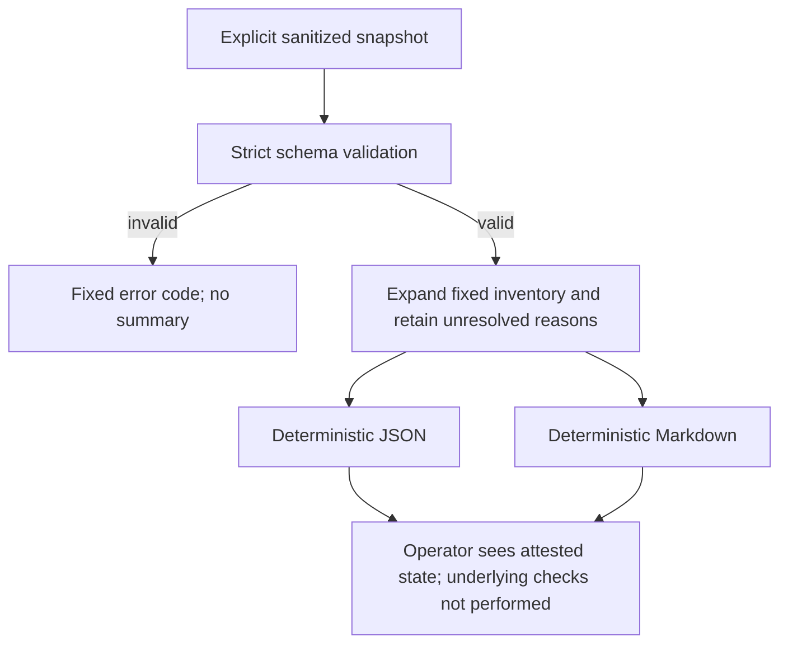
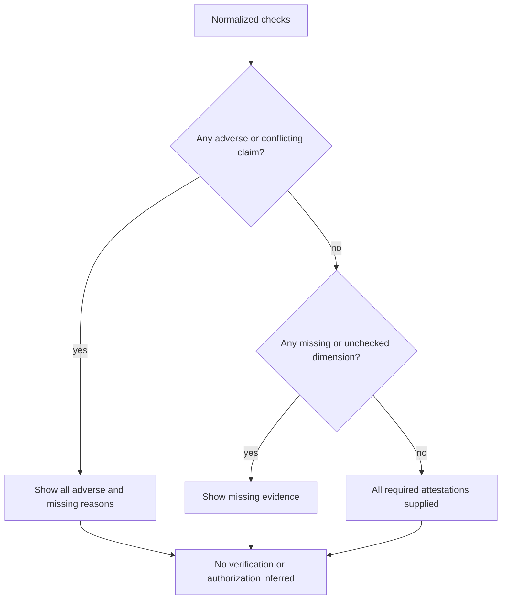

# Content-free campaign readiness - Plan

## Goal Capsule

- **Objective:** An operator can see which campaign input bindings, responsible roles, and completion receipts still need attention without opening evaluation content or starting a run.
- **Means:** An offline summary of explicitly supplied, content-free attestations (KTD1), with separate binding, ownership, and receipt states.
- **Scope:** Mandate item `fr-2`, an expansion, on `drawdown/fr-2` only.
- **Authority:** The controller's fr-2 mandate and standing campaign rules; `CLAUDE.md`; the three September 30 plans listed below. Chief authority is `docs/plans/2026-10-26-0705-feat-codex-drawdown-campaign-plan.md` in the chief repository, limited to its Goal Capsule and campaign R11, R15, R16, R17, R19, and R20.
- **Authority availability:** The chief plan and `ops/drawdown/mandates/_common.md` are absent from this sandbox. Their full text was not verified. The supplied standing rules govern this plan; the controller must reconcile the cited chief sections before dispatching the build. This requires controller context, not a new owner decision.
- **Execution boundary:** This stage commits the plan only. The later build remains offline and stops at local reviewed commits; the controller scans, pushes, and opens the PR, and the campaign merge gate handles merging.
- **Stop conditions:** No provider calls, spend, credential access, protected-input reads, security changes, data rewrites, migrations, releases, new services, deletion without backup, or force-push (R6, R7).

---

## Product Contract

### Summary

Add a small offline command that summarizes supplied status records for the U10 and retrieval campaigns. Show missing, adverse, stale, and conflicting evidence separately from favorable attestations. The summary describes what was reported; it performs no underlying campaign verification and grants no execution or adoption permission.

### Problem Frame

Campaign state is spread across plans, input bindings, controller ownership, and several kinds of receipts. A completed shard, an existing lock filename, a successful process exit, and a finalized report prove different things. Treating any one as campaign completion can hide missing replay or publication evidence and can encourage duplicate work.

The existing report builders evaluate results and open evaluation inputs. A content-free readiness view needs a separate boundary so an operator can inspect gaps without entering those execution paths.

### Requirements

These R-IDs are local to this plan. References to **campaign R17** mean branch isolation; **U10 R17** means the measured comparison verdict; **retrieval R11** means adoption gates.

**Evidence summary**

- R1. Cover the U10 and retrieval inventories in KTD2, showing every applicable required check even when the supplied snapshot omits it.
- R2. Preserve binding, responsible-role assignment, receipt presence/outcome, and currentness as separate attested dimensions; favorable completion claims must not hide unfavorable or missing dimensions.
- R3. Identify the evidence basis as `operator_attestation` and underlying verification as `not_performed` in every output. Full coverage means only that all required attestations were supplied, never that execution is authorized or a campaign is independently verified complete.
- R4. Output only fixed campaign/check/role labels, finite statuses, static reason codes, and derived counts. Accept no arbitrary prose, personal names, paths to evidence, item IDs, fingerprints, digests, commands, metrics, or verdict fields in the snapshot.
- R5. Generate deterministic JSON or Markdown from the same normalized summary, with explicit unresolved reasons and fixed follow-up descriptions. Invalid input produces a fixed diagnostic and no partial summary.

**Preservation and delivery**

- R6. Read only the explicitly supplied sanitized snapshot and the tool's own source/runtime dependencies. Do not discover campaigns, inspect locks, dereference evidence, read protected inputs or credentials, invoke producers, launch subprocesses or network calls, or mutate inputs, checkpoints, ledgers, reports, app pins, U10 R17, or retrieval R11.
- R7. Keep fr-2 in one branch and one expansion. Add offline tests without deleting or weakening existing tests; introduce no migration, data rewrite, release, outside service, dependency, or frontend change. Respect campaign R11 and R15–R20 as supplied in the dispatch.
- R8. Deliver locally for controller publication without requesting routine approval, locating credentials, or adding a remote. Record unavailable acceptance evidence honestly; a report of incomplete evidence is a useful result.

### Key Decisions

- **Guarded expansion delivery** (session-settled: user-directed — chosen over holding expansions for owner review: the campaign assigns publication and merge checks to its controller). Governs R7, R8.
- **Astra for campaign work** (session-settled: user-directed — chosen over a Sol-first ladder: the campaign fixes the model choice). Governs R8.
- **No owner wait through 2026-10-30** (session-settled: user-directed — chosen over waiting for owner input: the campaign proceeds with available authority). Governs R8.
- **Bound the lane to its item** (session-settled: user-directed — chosen over speculative features after useful work runs out: the campaign prefers durable hygiene). Governs R7.

### Scope Boundaries

fr-2 adds an evidence index, its CLI, generated fixtures, and usage guidance. It does not produce the underlying attestations automatically or validate their truth. Supplied currentness can be wrong; the summary must disclose this limit rather than infer freshness from a date or local file presence.

No cryptographic attestation service, provenance registry, lease/lock manager, background monitor, history merger, metadata checksum option, or new execution gate is needed. These mechanisms would create authority the summary cannot establish. A future explicit request for an authenticated producer would require its own scope and evidence.

#### Deferred to Follow-Up Work

- `fr-1`: actual replay, byte-identical regeneration, finalization, and branch reconciliation.
- `fr-3`: per-consumer paired-bootstrap and flag-parity adoption scorecards.
- `fr-4`: persona UAT rerun, branch/worktree reconciliation, and dependency audit.
- Live measurements and publication of measured results remain with their existing owning lanes.

---

## Planning Contract

### Reverified Starting State

Read-only inspection on 2026-10-26 found a clean `drawdown/fr-2` at `faf9bba5a1969daba0cb021f7de01b14e4bfe3e8`, including the bounded attribution canary. The only other local branch is `main` at `0a09f2c15b97458ab46429c1290e249578cbde73`, an older ancestor. No remote is configured. No readiness module, CLI, or test exists at the proposed paths. This is local source evidence, not a remote freshness or passing-test claim.

No tests, provider runs, checkpoint inspection, or protected-input reads were performed during planning. Historical completion counts and pending measurements in earlier plans were not re-certified.

### Key Technical Decisions

- KTD1. **Separate stdlib module and thin CLI.** Add `eval/folio_eval/campaign_readiness.py` and `eval/check_campaign_readiness.py`. Follow the launcher shape of `eval/run_recall_report.py` without importing campaign/report/consumer modules. `campaign_report` rendering reads benchmark IDs, and producer entrypoints can write state; they cannot be used as readiness probes (R3, R6).
- KTD2. **Versioned fixed inventories.** Use snapshot schema version 1 and exactly one campaign selector, `u10` or `retrieval`, per invocation. The table below owns the required inventory; names in each cell represent separate checks, not one aggregate success flag. Missing checks normalize to unknown/missing states; unknown or duplicate checks are invalid. No caller-defined check list may shrink the denominator (R1).
- KTD3. **Small attestation vocabulary.** A binding check accepts `matched`, `mismatched`, `not_checked`, or `conflict`; currentness accepts `current`, `stale`, `unknown`, or `conflict`. A receipt check separates presence (`present`, `absent`, `unknown`) from outcome (`passed`, `failed`, `not_checked`, `conflict`). Ownership separates assignment (`assigned`, `unassigned`, `unknown`, `conflict`) from the fixed responsible role (`controller`, `evaluation_operator`, `reviewer`, `unassigned`). No names or ownership-proof claims are stored. Currentness refers to the controller's intended campaign snapshot, not a clock or live repository check (R2–R4).
- KTD4. **Keep uncertainty visible.** Omitted fields normalize to unknown/not-checked, never favorable defaults. A receipt reported absent with a passed or failed validation outcome is structurally invalid. Completion reported passed alongside a mismatched binding, stale currentness, or missing owner is valid input with unresolved reasons. Preserve all applicable reasons in fixed order; do not select a winning claim. Ownership assignment does not establish exclusivity or authorization (R2, R3).
- KTD5. **One normalized summary, two renderers.** The command takes `--snapshot` and an optional `--format` of `json` or `markdown`, defaulting to JSON on stdout. Exit 0 means summary generation succeeded, including incomplete snapshots; input/usage failures return 2 and output failures return 1. Neither exit status nor full attestation coverage is a run/adoption gate. Use stable ordering, UTF-8 and a final newline, with no wall-clock, host, branch, or random values (R3, R5).
- KTD6. **Public-safe errors and isolated tests.** Reject unknown keys, duplicate JSON keys, wrong types, unsupported versions, unknown enums, and impossible field combinations before rendering. Do not echo parser exceptions, rejected values, filenames, or argument contents. Test the new boundary with fabricated temporary snapshots and controlled I/O, not existing corpus-reading fixture modules (R4–R7).

#### Required inventory

| Campaign | Dimension | Separate required checks | Source of meaning |
|---|---|---|---|
| U10 | Binding | Candidate source/runtime; corpus/config; leak-manifest binding; public metadata/output binding; pinned consumer environments | `docs/plans/2026-09-30-u10-finalization-recovery-plan.md`, units 3–4; `comparison_pilot` fingerprint and metadata validation |
| U10 | Ownership | Responsible controller assignment for finalization/publication | Same plan's Product Contract |
| U10 | Receipt | Shard receipt validation; final completion receipt; independent byte-identical regeneration; aggregate zero-collision acceptance; campaign report publication | Same plan's units 1, 5–6 and Verification Contract |
| Retrieval | Binding | Corpus/config/population; attribution/input-artifact binding; pinned consumer environments; shared campaign-directory binding; cumulative budget-ledger reconciliation | `docs/plans/2026-09-30-retrieval-loss-live-completion-plan.md`; `recall_consumers` campaign identity |
| Retrieval | Ownership | Responsible controller assignment for the shared measurement campaign | Same plan's ownership prerequisite |
| Retrieval | Receipt | Attribution finalization/R4 reconciliation; canary/projection review; each of the four consumer arms below; embedding ceiling; LLM ceiling; final report pair; zero-collision acceptance; experiment park entry | Same plan's units 2–5, with current arm contract below |

The retrieval arm checks are exactly `folio-enrich-deterministic`, `folio-mapper-deterministic`, `folio-mapper-gemini-3-flash-preview`, and `folio-mapper-gpt-6-luna`. Current `recall_consumers` rejects paid enrich arms by owner decision, and `recall_report.build_report` requires these four. The September 30 retrieval and downstream plans still describe six. Preserve the current code contract; do not reactivate the disabled arms or amend the old decisions in fr-2. Record this discrepancy in operator guidance.

Binding and receipt rows also carry responsible-role and currentness attestations. Campaign ownership is its own required row. Applicability follows the fixed row kind: do not demand a receipt-presence field for an ownership row or a binding outcome for a receipt row. Bindings remain explicit prerequisite rows, so receipt success cannot conceal them.

### High-Level Technical Design

### Assumptions and Dependencies

The mandate does not specify a transport or display format. This plan assumes a controller-authored JSON snapshot and JSON/Markdown stdout satisfy the requested summary. The snapshot describes the controller's intended campaign; it is not an export of protected receipts. No existing exporter is assumed or required.

Controller availability of the chief Goal Capsule and cited R-IDs is a build-dispatch prerequisite. Real campaign evidence is not a prerequisite for developing or verifying fr-2 on fixtures. Unknown actual ownership, budget, runtime, and completion remain unknown; no owner response is needed to build those states.

The new files do not depend on fr-1 landing first. If fr-1 changes producer semantics before implementation, re-read the cited contracts and update only the readiness inventory/test expectations needed to describe them. Do not merge or reconcile fr-1 branches here.

---

## Implementation Units

### U1. Define the content-free snapshot and reducer

**Goal:** Turn a partial snapshot into a complete, honest evidence index.

**Requirements:** R1–R4, R6, R7; KTD1–KTD4, KTD6.

**Dependencies:** Controller source reconciliation before build dispatch; no live artifacts.

**Files:** Create `eval/folio_eval/campaign_readiness.py` and `tests/test_eval_campaign_readiness.py`.

**Approach:** Define the fixed inventories and record kinds from KTD2. Parse and normalize only the KTD3 vocabulary, expand omissions, and compute ordered unresolved reasons under KTD4. Keep schema validation distinct from the fixed `not_performed` underlying-verification field.

**Patterns to follow:** Generated temporary receipt tests in `tests/test_eval_comparison_pilot.py`; explicit byte-versus-semantic binding distinctions in `eval/folio_eval/recall_report.py`. Reuse these ideas without importing those modules or fixtures.

**Execution note:** Start with fabricated tests for false acceptance: all-favorable receipt claims must not override missing ownership or mismatched bindings.

**Test scenarios:**

1. Empty and partial records expand the selected campaign's entire fixed inventory with visible missing dimensions.
2. Fully supplied favorable records produce only full attestation coverage and the R3 scope fields.
3. A passed receipt with mismatched binding, stale currentness, and unassigned ownership retains every unresolved reason.
4. Absent, present-unchecked, passed, failed, and explicit conflict receipts remain distinguishable; absent-plus-passed and invalid role/assignment combinations fail validation.
5. Unsupported versions, boolean-as-integer versions, duplicate keys/records, wrong types, unknown fields/enums, and inapplicable row fields fail without exposing supplied values.
6. Retrieval requires exactly the four current arm checks; omitted arms remain missing, and disabled enrich paid arms are rejected.

**Verification:** The dedicated generated-fixture tests prove both honest favorable output and refusal to hide incomplete or contradictory evidence.

### U2. Expose deterministic JSON and Markdown summaries

**Goal:** Let an operator run one offline command and see actionable evidence gaps.

**Requirements:** R3–R6; KTD1, KTD5, KTD6.

**Dependencies:** U1.

**Files:** Create `eval/check_campaign_readiness.py`; extend `eval/folio_eval/campaign_readiness.py` and `tests/test_eval_campaign_readiness.py`.

**Approach:** Add two pure renderers over U1's normalized result and the thin CLI. Use static follow-up descriptions addressed to fixed roles, such as supplying missing attestations or resolving conflicts outside this command. Implement the specified exit/error contract without output-file options or runtime discovery.

**Patterns to follow:** Thin entrypoint organization in `eval/run_recall_report.py`; independent generated fixtures rather than `tests/test_eval_campaign_report.py`, whose import reads corpus IDs.

**Test scenarios:**

1. Repeated runs and reordered input keys/records produce byte-identical output in each format; JSON and Markdown describe the same states.
2. Valid unresolved snapshots return 0 with visible gaps; invalid input/arguments return 2 without a summary; simulated output failure returns 1.
3. Generated private-looking sentinel values in unknown fields, invalid enum values, malformed JSON, and bad CLI arguments appear nowhere in controlled stdout/stderr or renderer output.
4. Instrumented library/CLI tests allow the supplied snapshot read and fail on attempted producer invocation, external file discovery, subprocess/network use, or lock acquisition.
5. Input bytes remain unchanged, and the CLI creates no report, checkpoint, ledger, or other output file.

**Verification:** Offline CLI smoke tests demonstrate both formats and all controlled failure paths. Interpreter and shell diagnostics outside the command are outside its error contract.

### U3. Document the snapshot boundary and verify integration

**Goal:** Make the summary usable without suggesting that it replaces campaign evidence or grants permission to run.

**Requirements:** R1–R8; KTD2, KTD5, KTD6.

**Dependencies:** U1, U2.

**Files:** Update `eval/README.md` and `tests/test_eval_campaign_readiness.py`; create `tests/fixtures/campaign_readiness.py` only if shared generated builders improve the dedicated tests.

**Approach:** Document the complete schema, fixed inventory, role meanings, one-command usage for both formats, exit semantics, and fully fabricated partial/favorable examples. Explain the four-versus-six-arm discrepancy and the separate responsibilities of the summary, underlying validators, and publishing controller. Keep sample data generated and public-safe.

**Test scenarios:**

1. The documented partial example yields visible gaps, and the favorable example carries attestation-only scope without an adoption verdict.
2. Both U10 and retrieval examples run without consumer checkouts, models, provider packages, credentials, or protected data.
3. The documented inventories agree with the new module's fixed contract, including independent U10 regeneration and explicit leak outcomes rather than process-exit inference.

**Verification:** Dedicated tests and relevant lint/type checks pass; existing behavior remains unchanged. Review records identify any broader checks that require a different environment instead of weakening or skipping tests silently.

---

## Verification Contract

Planning establishes source grounding only; it reports no runtime result. During the build, first establish the dedicated suite's baseline and new behavior using fabricated inputs. Use the repository's pytest configuration (`eval` on the import path), Ruff, and strict typing conventions from `pyproject.toml` and `.github/workflows/ci.yml`.

Run `tests/test_eval_campaign_readiness.py` in the cached local environment with no downloads or paid calls. Exercise the CLI boundary with controlled I/O; any subprocess used by a test harness must invoke only this local CLI. Check the new module's types explicitly because the default mypy target is `src/folio_resolve`. Preserve existing tests and report suitable regression checks and their exact results in the build receipt.

The existing campaign-report suite is not a corpus-free regression dependency: its module import opens committed evaluation rows. Inspect test collection dependencies before broadening local verification. Required existing CI checks remain required at the controller's merge gate; an inaccessible check is a recorded verification limitation, never a fabricated pass or reason to weaken it.

Generated output, README examples, the plan, and review receipts must contain no protected values or machine-local paths. Strict enum projection establishes the summary's content boundary; it does not claim a real manifest-backed leak scan. Any publication scan requiring protected inputs stays with the authorized controller, and its acceptance remains distinct from unit-test success.

The build retains a Codex review prompt and verdict artifact as required by `CLAUDE.md`, using only an artifact name and verdict in public receipts. No frontend is planned, so Playwright screenshot evidence is not applicable. Any later frontend addition belongs outside fr-2 unless explicitly authorized with the campaign's screenshot requirement.

---

## Definition of Done

- U1–U3 satisfy R1–R8 with isolated offline tests for the new behavior; existing tests are preserved.
- An operator can identify missing bindings, responsible roles, currentness, and receipts from either output format without opening evaluation content.
- Favorable attestations cannot become independent verification, campaign completion, execution authorization, or R17/R11 adoption decisions.
- Only the plan, dedicated readiness implementation/tests, and scoped usage guidance are changed. No producer, protected input, frozen evidence, app pin, or unrelated branch is altered.
- Review evidence and test limitations are recorded; abandoned implementation attempts are absent from the diff. Any cleanup that deletes data first has a verified backup.
- The branch is committed locally and handed to the controller for publication. No remote, login, or new owner decision is required in this sandbox.

**Rollback:** Revert only the fr-2 implementation/documentation commits. The additive command has no persisted campaign state, so rollback needs no migration or checkpoint repair.

### Sources

- `CLAUDE.md` — Codex review receipt and synthetic stop-rule boundaries.
- `docs/plans/2026-09-30-u10-finalization-recovery-plan.md` — finalization versus independent replay evidence.
- `docs/plans/2026-09-30-retrieval-loss-live-completion-plan.md` — ownership, cumulative budget, shared campaign, and completion dependencies.
- `docs/plans/2026-09-30-downstream-evidence-gated-adoption-plan.md` — preserved adoption responsibility.
- `docs/solutions/2026-09-07-u10-comparison-rerun-traps.md` — exact candidate binding and separate execution/publication prerequisites.
- `docs/solutions/2026-08-17-leak-gate-owner-scans-and-manifest-regeneration.md` — explicit scan outcome rather than process exit.
- `docs/solutions/2026-09-07-review-gate-catches-self-inflicted-regressions.md` — safe refusal direction and review-artifact handling.
- `docs/solutions/2026-09-19-synthetic-score-manifest-verification.md` — lane-specific validation and isolated fixtures.
- `docs/solutions/2026-09-30-frozen-evidence-blocks-library-edits.md` — preserve authenticated historical evidence.
