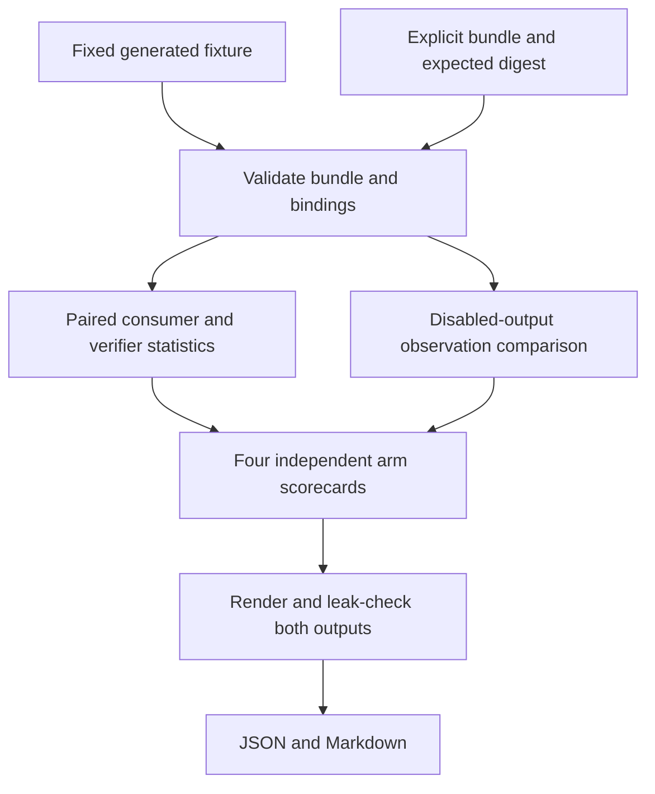

# Per-consumer Adoption Scorecards - Plan

## Goal Capsule

- **Objective:** An evaluation operator can see which adoption prerequisites each consumer satisfies, fails, or still lacks, and reproduce that assessment offline on generated fixtures.
- **Means:** A separate evidence reader and scorecard CLI that reuse the existing paired item-bootstrap statistics and evaluate strict disabled-flag observations.
- **Scope:** Drawdown item `fr-3`, an expansion on `drawdown/fr-3`. The build-stage dispatch authorizes implementation of U1-U3 on this branch.
- **Authority:** The supplied campaign dispatch and chief-repo `docs/plans/2026-10-26-0705-feat-codex-drawdown-campaign-plan.md`, specifically its Goal Capsule and campaign R11, R15, R16, R17, R19, R20; then this repository's `CLAUDE.md` and the source plans below. Campaign R-numbers and retrieval-plan R-numbers are separate namespaces.
- **Source limitation:** The chief repository is absent from this sandbox, so its Goal Capsule and cited R-IDs could not be independently read. The supplied dispatch provides the campaign constraints used here. The latest build dispatch authorizes offline implementation using its supplied constraints; the controller must reconcile those excerpts against the chief source before publication; no credential search or new remote is required.
- **Stop conditions:** Do not run providers, spend, inspect protected evaluation inputs, change adoption decisions, or expand into another mandate item. Missing real evidence is a reportable condition, not a reason to fabricate measurements or wait for Damien.

---

## Product Contract

### Summary

Add offline scorecards for folio-enrich and folio-mapper, with a separate assessment for each supported arm. Each card explains its paired F1 result, shared retrieval prerequisites, disabled-flag parity, and missing evidence while leaving adoption authority unchanged.

### Problem Frame

The existing retrieval report states the adoption guardrails but evaluates a next-lever recommendation. Its public aggregates omit the per-item false-positive counts needed to calculate paired consumer F1 intervals. The existing downstream diff also accepts some output changes as advisory, which cannot establish disabled-flag parity.

Operators therefore lack one reproducible view of the evidence needed for each consumer. Generated fixtures can establish that this view applies the gates correctly without accessing a live campaign or asserting that any consumer should adopt a change.

### Requirements

**Evidence and gate behavior**

- R1. Produce independent scorecards for the currently supported consumer arms, runnable offline on generated fixtures. Missing evidence for one arm must not erase or promote another arm's result. Source: mandate `fr-3`.
- R2. Compare each candidate only with its own consumer/arm R14 baseline on the same scoreable and no-match populations and evaluation-input binding. Supplied pairs must have unique, identical item sets; aggregate-only reports cannot substitute for paired rows. Source: retrieval-plan R11/R14 and the September 30 adoption plan.
- R3. Evaluate the unchanged retrieval R11 requirements: increased gold recall at depth 100; a paired item-bootstrap, two-sided 95% interval for verifier micro-F1 gain wholly above zero; verifier precision at least `0.033`; shortlist depth fixed at 100; and a paired item-bootstrap 95% interval for each consumer's micro-F1 gain above its own R14 baseline wholly above zero.
- R4. Evaluate disabled-flag parity from complete, bound observations of the baseline and the same candidate with its opt-in flag disabled. Equal metrics or a legacy nonblocking diff do not establish parity. Source: September 30 adoption plan.
- R5. Report baseline and candidate precision, recall, F1, and no-match false-positive numerator, denominator, and rate, together with interval metadata and reasons for every unmet prerequisite. Controls remain separate from the scoreable F1 population; no additional no-match rejection threshold is introduced.
- R6. Distinguish missing evidence, a measured gate failure, and malformed or mismatched evidence. Fixture success must never claim measured improvement, reviewed integration, or adoption authorization; existing R17 verdicts and R11 adoption decisions remain untouched.

**Safety and delivery**

- R7. Reports and diagnostics contain only allowed aggregate fields, fixed labels/reasons, and permitted evidence digests. Do not publish item identifiers, text, IRIs, source paths, arbitrary metadata, or exception details; generated reports retain leak checking.
- R8. Add coverage for the expansion and preserve every existing test and behavior. Work uses generated fixtures without provider calls, protected data, new dependencies or services, schema migrations, data rewrites, package releases, or consumer-repository changes. Source: campaign R11/R15/R16 and the repository mandate.
- R9. Keep this item on its assigned branch and commit locally. The controller owns scanning, push and PR creation; the campaign gate owns merge. No remote, login, credential, security-setting, deletion, or force-push work belongs here. Source: campaign R15/R17/R19/R20.

### Key Decisions

- **Expansions proceed through the campaign guardrails.** (session-settled: user-directed — chosen over holding expansions for individual review: the campaign delegates acceptance to its gate.) Governs R8, R9.
- **Work uses Astra.** (session-settled: user-directed — chosen over the Sol-first ladder: the campaign names Astra for this work.) Governs R9.
- **Missing live evidence does not wait on Damien.** (session-settled: user-directed — chosen over waiting for decisions through 2026-10-30: the offline work can finish and report what remains absent.) Governs R6, R9.

### Scope Boundaries

The active work is the evidence contract, mechanical gate evaluator, fixture demonstration, report output, tests, and usage documentation. There is no front-end change, so the campaign screenshot requirement is not triggered.

Do not modify `comparison.classify_verdict`, `downstream.diff_snapshots`, `recall_report.choose_lever`, frozen evidence validators, source pins, experiment ledgers, campaign checkpoints, or application flags. No edits belong in `src/folio_resolve/`, the consumer repositories, or the existing benchmark reports. This preserves R6/R8.

Considered and excluded: a general evidence registry, approval registry, live exporter, checkpoint discovery, configurable parity exclusions, and bootstrap framework replacement. The existing contracts and explicit input bundle suffice; a later concrete producer or integration requirement would justify revisiting an adapter.

Other drawdown items remain separate: U10 replay and branch reconciliation (`fr-1`), campaign readiness (`fr-2`), and hygiene (`fr-4`). The standing choice of durable hygiene over speculative features applies after assigned work runs out; it does not add work to this branch.

### Acceptance Examples

- AE1. **Covers R1-R6.** Generated evidence gives enrich a positive paired gain and matching disabled outputs, while mapper has a zero-crossing interval. Both scorecards appear with distinct gate results; neither authorizes adoption.
- AE2. **Covers R2, R6.** A valid bundle has no mapper baseline section. Mapper shows missing evidence. A supplied mapper baseline with a duplicate item or different corpus binding instead rejects the input before output.
- AE3. **Covers R4.** Flag-off predictions change while TP/FP/FN totals stay equal. The observation digests differ and parity fails.
- AE4. **Covers R3, R5.** Precision exactly `0.033` passes its gate, but a lower F1 bound exactly zero does not pass. A no-match regression remains visible without inventing a new adoption threshold.

---

## Planning Contract

### Reverified Starting State

Read-only inspection on 2026-10-26 found a clean `drawdown/fr-3` at `faf9bba5a1969daba0cb021f7de01b14e4bfe3e8`. Local `main` is the older ancestor `0a09f2c15b97458ab46429c1290e249578cbde73`; this plan preserves the supplied branch history. Build-stage read-only revalidation found the branch clean at `524922e`, containing this plan and no scorecard implementation. The five document-review lenses returned no findings; cross-model review is disabled by checkout configuration. Remote freshness was not checked. No tests or evaluation commands were run during planning, so these observations are not a passing baseline receipt.

| Evidence | Consequence for fr-3 |
| --- | --- |
| `eval/folio_eval/report.py`: `PairedItem`, `f1_delta`, `bootstrap_ci` | Reuse the paired micro-F1 statistic and deterministic resampler. |
| `report.pair_items` intersects IDs and collapses duplicates through dictionaries | Validate full cohorts before constructing paired units directly. |
| `eval/folio_eval/comparison.py`: `classify_verdict` bootstraps mean item-F1 deltas | Preserve R17's different statistic and existing results. |
| `eval/folio_eval/recall_consumers.py`: `REQUIRED_PUBLISHED_ARMS` | Support enrich deterministic, plus mapper deterministic, Gemini and Luna. |
| `eval/folio_eval/recall_report.py`: `build_report`, `GUARDRAILS` | Public aggregate inputs cannot supply paired F1 evidence; guardrail prose is not an evaluated gate. |
| `eval/folio_eval/downstream.py`: `diff_snapshots` | A strict parity comparison must be separate from the advisory regression diff. |

The September 27 plan's current R13 and the code agree on four arms. The September 30 documents still mention six; do not restore enrich LLM arms or alter the current publication-arm validator. Fixture sample sizes are independent of the real report's 30-control requirement.

### Key Technical Decisions

- KTD1. **Add a standalone eval module.** Put the new policy in `eval/folio_eval/adoption_scorecard.py` and a thin launcher, leaving the functions in the starting-state table unchanged. Frozen validators and historical reports must retain their original meaning. Governs R1, R6, R8.
- KTD2. **Use one versioned, content-free evidence bundle.** A finite typed contract supplies counts and observation hashes explicitly; it neither traverses checkpoints nor attempts to reconstruct item outcomes from aggregates. The detailed contract below governs validation under R2/R4/R6.
- KTD3. **Reuse paired micro-F1 computation after strict validation.** Build sorted `PairedItem` units and call `bootstrap_ci` with `f1_delta`, retaining the repository defaults of 2,000 resamples and seed `20260727`, with `alpha=0.05`. Do not call the intersection-based pairing helper or reuse R17's classifier. Compare unrounded bounds; serialize enough precision to explain a small positive bound. Governs R3/R5.
- KTD4. **Measure recorded-observation parity.** Compare exact per-item semantic-output fingerprints with a fixed projection version and complete coverage. This establishes parity for the declared observations, not every application behavior. Do not derive it from counts or a caller-provided `passed` boolean. Governs R4/R6.
- KTD5. **Keep results descriptive.** Every gate has `pass`, `fail`, or `missing`; the mechanical aggregate is `fail` if any evaluated gate fails, otherwise `missing` if any required evidence is absent, otherwise `pass`. Preserve every reason and a separate completeness field. All outputs set `adoption_authorized: false`; fixture and recorded evidence are labeled separately. Governs R5/R6.
- KTD6. **Render deterministic JSON and Markdown from one result.** Stable ordering, fixed vocabulary and no timestamps make identical input bytes produce identical output bytes. Output includes the exact input-byte digest, so reordered input preserves metrics and gate results but may change that digest. Preflight and scan both rendered outputs before publication. Governs R5/R7.

### Evidence Contract

The new file format is an additive harness input, not a migration of existing evidence. Field names can follow local conventions; the following semantics are required by KTD2.

| Section | Required meaning and validation |
| --- | --- |
| Envelope | Schema version, `generated_fixture` or `recorded_input`, explicit population counts, and common corpus/gold/ontology/scoring-rule digests. Reject unknown fields and nonfinite JSON numbers. |
| Identity | Fixed consumer/arm identity; distinct baseline and candidate source digests; the baseline's R14 evidence reference; and a common lever identity linking app, verifier and recall evidence. Identity fields are not paths. |
| Scoreable evidence | Baseline/candidate rows keyed by opaque item key, with nonnegative integer TP/FP/FN, positive gold count, and nonnegative predicted count. Reject booleans, duplicates, unequal key sets, zero scoreable population, and inconsistent arithmetic. Gold count agrees per pair and across evidence sections sharing the cohort. |
| No-match evidence | Explicit disjoint control keys and predicted-count rows for baseline/candidate. Require equal paired control sets; zero controls makes the requested rate unavailable and completeness false, never a fabricated zero. |
| Recall and verifier evidence | Bound baseline/candidate shortlist-hit counts between zero and the common positive gold denominator, with positive integer measured depth; paired verifier count rows; explicit verifier/configuration identity. These share the common evaluation binding and lever, while keeping their own source references. |
| Disabled-flag observations | Bound baseline and candidate identities, explicit disabled state, projection version, and one output digest per observed scoreable/control key on each side. Require full declared coverage. Missing observations are not empty results. |

The parity projection represents the complete structured result for each declared probe, including ordered results, scores, abstentions, and any returned span/location fields. Preserve meaningful order; canonicalize JSON object keys only. Exclude timing and execution metadata outside that result, with no configurable field exclusions. Fixtures construct small artificial result objects before hashing; recorded-input producers must use this same versioned contract.

The four arm slots are fixed by the current allowlist. Emit all four; an absent arm or prerequisite is represented by JSON `null` and produces a missing gate. A present section must be complete and well formed. Unknown/duplicate arms, mismatched binding, corrupt file digest, or a present malformed section reject the whole bundle. A well-formed observation at depth 99 or with nonpositive gain is a gate failure, not a parser error. Missing required metrics, including a rate without controls, keep the aggregate result missing unless an evaluated gate fails under KTD5.

Use an expected raw SHA-256 argument to authenticate the supplied bundle bytes before parsing, following `recall_report.load_bound`. Source references inside the bundle are checked for agreement, not fetched. A self-consistent hash or `recorded_input` label does not prove that a record is an authentic R14 baseline or that an integration was reviewed. Actual source authentication and app adoption remain outside this scorecard; the report states that limit under R6.

### High-Level Technical Design

| Condition | CLI behavior | Scorecard behavior |
| --- | --- | --- |
| Wrong bytes, schema, arithmetic or identity | Nonzero; fixed safe error; no publication | No misleading partial report |
| Explicitly absent evidence | Successful report | Missing gates and reason codes |
| Valid measured failure | Successful report | Failed gate plus other available results |
| Every mechanical gate passes | Successful report | Pass, with adoption authorization still false |
| Output leak collision or occupied destination | Nonzero; preserve prior outputs | No replacement |

### Assumptions and Dependencies

- JSON plus Markdown, a finite four-arm report, and a built-in fixture demonstration are implementation defaults inferred from the repository's report conventions. They are not new product-policy decisions.
- Existing per-item measurements and live parity captures are not prerequisites for building or testing fr-3. No exporter from real checkpoints is included; future recorded use needs a producer that supplies the evidence contract accurately.
- The controller reconciles the unavailable chief-plan excerpt before publication under the latest build dispatch. No other planning question requires Damien's time.
- Replay determinism applies to identical input bytes and the supported Python environment. Cross-version random-number or numerical equivalence is verified rather than assumed.

---

## Implementation Units

### U1. Validate paired evidence and provide generated fixtures

**Goal:** Admit enough bound, per-item evidence to evaluate R2-R4 without consulting real campaign files.

**Requirements:** R1, R2, R6-R8; KTD1, KTD2; AE2.

**Dependencies:** The supplied build dispatch authorizes offline implementation; controller reconciliation of the campaign source limitation remains a publication prerequisite. No dependency on fr-1, fr-2, live measurements, or consumer checkouts.

**Files:** `eval/folio_eval/adoption_scorecard.py` (new); `eval/fixtures/adoption-scorecard-v1.json` (new, wholly generated); `tests/test_eval_adoption_scorecard.py` (new).

**Approach:** Define the narrow input types, strict parser and identity validation from KTD2. Provide a small fixed fixture with supported arm slots and synthetic count/hash evidence. Keep fixture lineage explicit; never copy or transform protected evaluation rows.

**Patterns to follow:** `recall_report.load_bound`; generated dictionaries in `tests/test_eval_recall_report.py`; temporary fixtures in `tests/test_eval_comparison.py`.

**Execution note:** Establish rejection cases before wiring the evaluator so partial cohort joins cannot look successful.

**Test scenarios:**

1. Covers AE2. Missing arm or prerequisite yields structured absence; a supplied malformed section rejects the whole bundle.
2. Duplicate, missing, extra, or overlapping scoreable/control keys reject; ordering differences alone remain valid.
3. Wrong consumer/model, baseline reference, lever, corpus, configuration, ontology or candidate binding rejects, including parity evidence for a different candidate.
4. Negative, boolean, fractional or nonfinite counts, impossible TP/FP/FN totals, and changed per-item gold reject.
5. Aggregate-only input, an unknown arm, unknown fields, or an incorrect expected file digest rejects without echoing input content.
6. A tiny valid fixture is accepted without requiring the live population size, optional ontology packages, app checkouts or protected files.

**Verification:** The parser accepts only the intended contract and preserves missing evidence distinctly. Existing input loaders and validators remain unchanged.

### U2. Evaluate paired gain and strict observation parity

**Goal:** Explain every arm's mechanical gate outcome using the unchanged adoption criteria.

**Requirements:** R1-R6, R8; KTD3-KTD5; AE1, AE3, AE4.

**Dependencies:** U1.

**Files:** `eval/folio_eval/adoption_scorecard.py`; `tests/test_eval_adoption_scorecard.py`.

**Approach:** Use the validated rows to construct paired units and compute metrics. Evaluate the shared lever evidence and each arm's own baseline separately, then combine only that arm's required gates under KTD5. Return fixed reason codes and provenance/completeness metadata, without writing files or mutating any existing verdict.

**Patterns to follow:** `report.PairedItem`, `report.f1_delta`, `report.bootstrap_ci`; no-match metric semantics in `recall_consumers.attribute_consumer`.

**Test scenarios:**

1. Covers AE1. Enrich and mapper fixtures yield different results without cross-arm baseline substitution or averaging.
2. An unequal-item-size fixture distinguishes micro-F1 gain from mean item-F1 gain; existing R17 expectations stay unchanged.
3. Covers AE4. Positive, zero-crossing, exactly-zero, and wholly-negative intervals have the expected gate results, including a tiny positive bound that rounds to zero at six decimals.
4. Recall equality fails its improvement gate, depth 99 fails its depth gate, and precision immediately below versus exactly `0.033` straddles the existing floor.
5. Covers AE3. Changed semantic digests fail parity despite identical counts; added, removed or mismatched observations reject coverage, while complete equal observations pass.
6. Missing parity or verifier evidence remains missing, never defaults to pass; failed-plus-missing gates retain both reasons and follow KTD5 precedence.
7. Zero controls produce unavailable control metrics; nonempty controls yield the exact false-positive numerator and rate without entering the F1 calculation.
8. Sorting input rows preserves statistics and reasons; repeated identical inputs reproduce intervals and resampling metadata.
9. All-pass fixtures and recorded-input-shaped fixtures still set adoption authorization false and do not touch R11/R17 artifacts.

**Verification:** Hand-checkable fixtures establish the statistic, threshold boundaries, cohort handling, parity coverage and arm independence. Legacy comparison, report and downstream tests retain their original assertions.

### U3. Deliver a safe offline CLI and readable scorecards

**Goal:** An operator can generate inspectable fixture scorecards with one command and repeat them without provider access.

**Requirements:** R1, R5-R9; KTD1, KTD6.

**Dependencies:** U1, U2.

**Files:** `eval/run_adoption_scorecard.py` (new); `eval/folio_eval/adoption_scorecard.py`; `eval/fixtures/adoption-scorecard-v1.json`; `tests/test_eval_adoption_scorecard_cli.py` (new); `eval/README.md`.

**Approach:**

1. Add mutually exclusive fixed-fixture and explicit-bundle entry paths, with no implicit discovery. The fixed demonstration cannot accept arbitrary evidence under its fixture label; explicit input requires the expected digest and explicit leak-check inputs.
2. The fixed demonstration uses only generated leak-check material. Explicit-input tests also generate their manifest and synthetic salt locally; no protected salt or manifest is read in this work.
3. Render a compact per-consumer Markdown table and matching JSON containing each arm, metrics, intervals, individual gates, missing reasons and evidence limits. Apply the existing leak scanner to both outputs before any publication.
4. Require an explicit, new destination directory and refuse an existing destination path. Stage the complete pair before exposing the destination; on an I/O failure return nonzero without deleting or overwriting prior artifacts. Do not add an overwrite switch.
5. Document the fixed fixture invocation, input contract, exit semantics, parity coverage and the distinction between a mechanical pass and actual adoption.

**Patterns to follow:** Thin launchers such as `eval/run_recall_report.py`; rendering and leak preflight in `recall_report`; atomic-write conventions in `comparison.py` and `leakcheck.py`.

**Test scenarios:**

1. A subprocess fixture invocation works from an unrelated working directory, with no consumer checkouts, provider credentials or optional model dependencies.
2. The fixed demonstration creates both formats, labels fixtures, and matches the public metrics/reasons of the pure evaluator.
3. Repeating identical input into two fresh destinations produces byte-identical files. Reordering input preserves result values while allowing its raw-byte digest to change.
4. Explicit-input mode verifies the expected digest and all required leak-check inputs; missing input files are errors rather than missing gates.
5. Generated benign and planted-collision manifests exercise the real scanner; collisions and invalid input produce no newly published pair and preserve existing files.
6. Occupied destinations and injected publication failure never overwrite prior evidence or claim successful completion.
7. JSON, Markdown, stdout and stderr omit planted item keys, text, IRIs, paths and arbitrary metadata. Network/provider and external-process seams are unavailable during the fixture execution.

**Verification:** The documented one-step demonstration succeeds offline, its two outputs agree, failure paths preserve evidence, and the CLI cannot dispatch a measurement or alter adoption state.

---

## Verification Contract

The build must first establish a fresh offline baseline; planning did not execute tests. Use the existing prepared environment and dependency caches, with no downloads or optional-model installation. Record baseline failures separately from new regressions, including sandbox socket restrictions; an unavailable check is not a pass and must be rerun by the controller where supported.

| Check | Scope and required evidence |
| --- | --- |
| New evaluator and CLI tests | `tests/test_eval_adoption_scorecard.py`, `tests/test_eval_adoption_scorecard_cli.py`; all U1-U3 scenarios pass. |
| Focused legacy regressions | `tests/test_eval_score.py`, `tests/test_eval_comparison.py`, `tests/test_eval_downstream.py`, `tests/test_eval_recall_consumers.py`, `tests/test_eval_recall_report.py`; existing assertions and expected verdicts remain intact. |
| Default core suite | Repository command `uv run --offline --no-sync pytest -ra`; keep the existing `embedding_integration` exclusion and do not add skips. |
| Static checks | `uv run --offline --no-sync ruff check .` and `uv run --offline --no-sync mypy`; inspect changed eval-module typing as well as the configured library scope. |
| Fixture CLI | Proposed usage: `uv run --offline --no-sync python eval/run_adoption_scorecard.py --fixture-demo --out-dir scorecard-demo`; use fresh temporary destinations for verification. |
| Determinism and privacy | Compare both output files from two identical runs; exercise real leak-check logic with generated material and verify no protected-input or network access. |
| Source boundary and review | Only the named fr-3 files change; no existing test is deleted or weakened. Retain the Codex review prompt and verdict outside the public tree, publishing only the safe receipt name/verdict required by `CLAUDE.md`. |

No screenshot is required for this CLI/report change. Any later front-end addition is a scope change and would trigger the campaign's Playwright evidence rule.

---

## Definition of Done

- U1-U3 deliver independent, reproducible fixture scorecards with all required gate and provenance distinctions.
- The verification contract has passing evidence for supported checks, with any environment limitation explicitly routed to the controller before merge.
- Existing statistics, frozen artifacts, adoption decisions, tests and consumer flows remain unchanged; the diff contains no abandoned implementation attempts.
- The public diff and generated fixture artifacts pass the applicable confidentiality checks and a recorded Codex review.
- Work is committed locally on `drawdown/fr-3`; publication remains the controller's responsibility under R9. No live campaign or actual adoption completion is claimed.

Rollback is a focused revert of the new scorecard feature and its documentation. No checkpoint, existing report, source pin, protected data or consumer configuration requires restoration.

---

## Sources

- `docs/plans/2026-09-30-downstream-evidence-gated-adoption-plan.md` — per-consumer baseline, pairing, opt-in and disabled-parity requirements.
- `docs/plans/2026-09-27-1922-feat-retrieval-recall-loss-attribution-plan.md` — current R11/R13/R14; distinguishes adoption from R9/R10 lever selection.
- `docs/plans/2026-09-30-u10-finalization-recovery-plan.md` and `docs/plans/2026-09-30-retrieval-loss-live-completion-plan.md` — neighboring replay and measurement ownership; these remain separate work.
- `docs/plans/2026-08-16-001-feat-synthetic-benchmark-f1-campaign-plan.md`, KTD12 and U9 amendments — synthetic `park` behavior and firm-lane stop-rule boundary.
- `docs/solutions/2026-09-04-u9-iteration-traps.md` and `docs/solutions/2026-09-07-u10-comparison-rerun-traps.md` — baseline isolation and measured candidate identity.
- `docs/solutions/2026-09-07-review-gate-catches-self-inflicted-regressions.md` and `docs/solutions/2026-09-19-synthetic-score-manifest-verification.md` — rounding boundaries, fixture isolation and confidentiality verification.
- `docs/solutions/2026-09-30-frozen-evidence-blocks-library-edits.md` — preserve authenticated historical evidence and frozen validator semantics.
