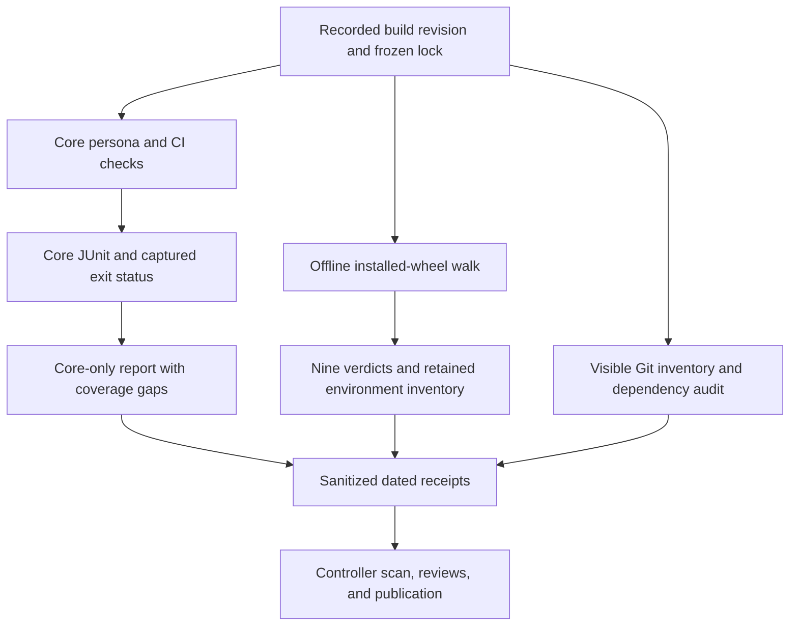

# fr-4 Offline UAT and Repository Hygiene - Plan

## Goal Capsule

- **Objective:** Maintainers can tell which consumer workflows pass today, which dependency checks are supported by evidence, and which branches or worktrees still need attention before later evaluation work.
- **Means:** Reuse the persona and installed-wheel harnesses, add truthful core-only reporting, and publish dated maintenance receipts (KTD1–KTD5).
- **Authority:** The `fr-4` mandate and supplied campaign rules govern this item; `CLAUDE.md` and the three September 30 evaluation/adoption plans govern repository boundaries. Campaign references below mean the chief repository's `docs/plans/2026-10-26-0705-feat-codex-drawdown-campaign-plan.md`, not this plan's local R-IDs.
- **Source limitation:** The chief campaign plan and `ops/drawdown/mandates/_common.md` are absent from this isolated checkout. The dispatch supplies the campaign goal and R11/R15/R16/R17/R19/R20 constraints used here. The controller must check the canonical Goal Capsule and those R-IDs before build dispatch; no independent reading of the missing source is claimed.
- **Execution profile:** One hygiene item on `drawdown/fr-4`. This document authorizes later build work, not execution during the planning stage. The lane commits locally; the controller owns publication and the campaign merge gate (R8).
- **Stop conditions:** Stop only the affected operation if it would violate R5–R8. Record missing cache, inventory, advisory, or publication evidence without claiming success or waiting for an unnecessary owner decision.

---

## Product Contract

### Summary

Rerun the existing offline consumer acceptance checks and replace stale maintenance assumptions with current, scoped receipts. Add a core-only report option so an unavailable extras run is represented honestly. Reconcile visible Git state without removing anything, and audit dependencies without changing their versions.

### Problem Frame

The committed September 30 UAT report describes an earlier revision. The October 20 handoff records later core checks, but neither proves the current branch's acceptance state. Older hygiene plans also describe worktrees and unmerged branches that this clone cannot see. Maintainers need fresh evidence without disturbing evaluation checkpoints or treating missing evidence as a pass.

### Re-verified starting state

These are static observations from October 26; no tests, builds, installs, or vulnerability scans ran during planning.

| Surface | Observed state | Consequence |
|---|---|---|
| Working branch | Clean `drawdown/fr-4` at `faf9bba5a1969daba0cb021f7de01b14e4bfe3e8` | Recheck the actual build starting revision. |
| Local base and visibility | `main` at `0a09f2c`, seven commits behind the starting branch by ancestry; two local branches, one worktree, no remotes | Local `main` is not proof of the controller's current base. |
| Persona acceptance | Eight personas and 24 story IDs in `docs/uat/`; latest dated report records `984b4125651908e78d441d4a7e476d911c0bd655` | Historical passes must not become fresh results. |
| Report generator | `tests/uat/build_report.py` requires two JUnit inputs and always labels the primary one as extras | A genuine core-only rerun needs a bounded reporting correction. |
| Raw evidence storage | `.codex-out/uat/` is not ignored by this checkout | Establish a scoped ignore rule before acceptance outputs are written. |
| Consumer walk | `tests/uat/consumer_walk.py` supports `--offline` and `--keep-venv`; install resolution is not constrained by `uv.lock` | Preserve the environment and identify its actual installed versions separately. |
| Dependencies | Package version `0.4.0`; Python `>=3.11`; core requirement is Pydantic; four extras; 105 lock entries including alternate NumPy versions | A union of lock entries is not an installed environment. |
| Existing checks | Core CI covers Python 3.11/3.12, frozen core plus dev dependencies, Ruff, and library mypy on 3.11 | Use this contract without implying a fresh CI result. |
| Repository declaration | `.cockpit-repo.json` records September 30 UAT and unresolved Python 3.13 NumPy-stub friction | Do not clear the old finding without applicable new evidence. |

### Requirements

**Acceptance evidence**

- R1. Produce a fresh persona report from actual JUnit evidence, retaining every catalog story and distinguishing failures, skipped tests, untested stories, and unavailable extras coverage. Existing two-lane reporting remains compatible.
- R2. Rerun the installed-wheel consumer walk and record all nine step verdicts, its tested revision, interpreter, and observed installed distributions. Zero process exit alone does not establish full acceptance.

**Repository and dependency hygiene**

- R3. Classify each visible branch and worktree against explicitly recorded revisions, preserving all refs, worktrees, dirty files, ignored data, and unmerged work. Missing controller inventory remains unverified.
- R4. Audit declared dependencies, locked versions and markers, selected core/dev packages, optional-extra coverage, and build tools. Known-vulnerability conclusions require dated advisory evidence with package coverage and lookup failures recorded.

**Preservation and delivery**

- R5. Preserve every existing test, frozen receipt, hashed benchmark validator, and protected evaluation input. Add regression tests for reporting changes; do not change the U10 R17 verdict, retrieval R11 adoption decisions, or stop-rule semantics.
- R6. Run acceptance checks using generated fixtures and cached dependencies, with real-ontology opt-in disabled and interpreter/model downloads prohibited. No paid/provider runs, credentials, security-setting changes, migrations, data rewrites, package releases, or new service integrations belong to this item.
- R7. Commit only public-safe summaries with repo-relative paths. Keep raw logs, machine-local paths, reviewer prose, protected-input details, and matched leak terms out of durable artifacts; the controller supplies the required publication scan.
- R8. Keep this work on `drawdown/fr-4`, commit locally, and leave pushes, PRs, campaign reviews, and merging to the controller. Do not add a remote, seek a login, delete or prune work, or force-push.

R5–R8 carry the dispatch's campaign R11, R15, R16, R17, and R19 guardrails. Campaign R20 governs a genuine owner-only blocker: finish independent work and record the needed action, setting, minutes, and what it unblocks. No such owner-only decision is presently established.

### Key Decisions

- **Durable hygiene is the scope.** (session-settled: user-directed — chosen over speculative features: the campaign assigns remaining maintenance work.) Governs R1–R4.
- **The lane proceeds without owner waiting time.** (session-settled: user-directed — chosen over waiting for review through October 30: independent work must keep moving.) Governs R8 and the campaign R20 handling above.

### Scope Boundaries

This item does not resume the September hygiene plan's release, pruning, handoff-retirement, or unrelated branch-shipping units. U10 replay and U10 branch-content integration belong to `fr-1`; readiness summaries and adoption scorecards belong to `fr-2` and `fr-3`. Their branches may be listed in the inventory without changing their work.

No application UI change is planned. A later front-end change would require the campaign's committed Playwright screenshot under `docs/plans/evidence/`; it is not a reason to add UI work here.

Considered and not built: a new dependency-audit platform, new consumer lock-enforcement flags, and a cleanup daemon. Existing tools and retained-environment inspection cover the maintenance request; observed inability to capture the required evidence would justify reconsidering only the affected mechanism.

#### Deferred to Follow-Up Work

Dependency upgrades, behavior changes in the library, optional model/ontology acquisition, and release preparation need separately scoped work. Report any discovered defect with its evidence and disposition; do not weaken a test or silently expand this branch to fix unrelated production behavior.

---

## Planning Contract

### Key Technical Decisions

- KTD1. **Add an explicit core-only report mode.** Extend `tests/uat/build_report.py` with `--core-only`, using `--core-junit` as the evidence input and omitting `--junit`. Reject a simultaneous extras input in that mode. Preserve the existing dual-input invocation and its output contract; duplicating core XML into the extras position would misrepresent R1.
- KTD2. **Use test-run provenance and expose coverage separately.** Core-only metadata comes from the core XML through the existing metadata reader. Keep its visibly labeled fallback behavior, but a fallback is insufficient for a fresh acceptance receipt. Preserve story aggregation while adding testcase pass/fail/skip counts, skipped testcase identities/reasons, and an untested-story count to the new mode. Its rerun text uses frozen/offline core execution and never enables real ontology. This implements R1 without rewriting legacy output.
- KTD3. **Separate frozen core validation from the consumer environment.** Use cached Python 3.11 and the frozen core/dev lock selection for the required core checks; record any unavailable Python 3.12 matrix leg. Run the consumer walk with its existing `--offline` and `--keep-venv` options, then capture installed distribution names/versions from the retained interpreter. Label this as the post-walk environment, after its typing-tool install, not proof that every earlier step used the lock (R2, R4, R6).
- KTD4. **Reconciliation produces dispositions, not deletions.** Record visible ref tips, ancestry, worktree state, and retention reasons. Keep the planning start, build start, and controller-confirmed base distinct. Do not infer merge status from ref absence or patch similarity; the latter may be supplemental evidence only (R3, R8).
- KTD5. **Audit the frozen inventory without automatic repair.** Use `uv.lock` as the dependency authority and temporary exports as audit inputs, not a second maintained manifest. Separate core, dev, each optional extra, and build-tool coverage; record the Python/platform scope of marker selection. When available, use an isolated `pip-audit` tool with exact pins, dependency resolution disabled, JSON output, and no fix option. Its public advisory lookup is an audit read, not an application integration; send only public package/version metadata. If the tool or advisory access is unavailable, record incomplete coverage and an exact controller follow-up, never a clean verdict. [uv export documentation](https://docs.astral.sh/uv/concepts/projects/export/) supports temporary exports; [PyPA pip-audit documentation](https://github.com/pypa/pip-audit#usage) documents the no-resolution options and advisory behavior. Governs R4 within R6.
- KTD6. **Publish current receipts separately from historical reports.** Create the dated artifacts named in U1/U3/U4, preserving September reports. Bind acceptance to a clean code revision after reporting changes are committed; later report-only commits cite that tested revision. The existing declaration may be refreshed only after required core and consumer coverage is complete; otherwise retain its historical date/status and add a concise unresolved finding. Keep the older Python 3.13 finding unless that environment is actually revalidated (R1, R2, R7).
- KTD7. **Establish ignored raw-evidence storage before the rerun.** Add the narrow `/.codex-out/uat/` rule to `.gitignore`, preserving every existing exclusion. Store raw UAT and dependency-audit output there; keep source, tests, and published receipts outside that rule. The current checkout lacks this protection, so U2 must establish it before U3/U4 write output (R7).

### Assumptions and Dependencies

- The build stage will have some cached Python/tooling inputs. Their availability is an execution-time check, not a planning result; a cache miss leaves the affected leg unavailable without changing the lock.
- The controller can supply its current base and wider inventory, and can check the missing canonical campaign excerpts. Local work can proceed independently, but wider reconciliation cannot be called complete without that evidence.
- Public advisory access may be unavailable in the build sandbox. Record source/date and completeness for any cached advisory evidence; stale or partial evidence cannot establish a current all-clear.
- Raw evidence stays in ignored output storage or retained task scratch. Only sanitized summaries are committed; unavailable protected publication scans are controller-owned release evidence, not permission to inspect restricted inputs.

### Repository Authorities and Learnings

- `docs/plans/2026-09-30-u10-finalization-recovery-plan.md` owns preserved U10 replay; this item does not perform its units 3–6.
- `docs/plans/2026-09-30-retrieval-loss-live-completion-plan.md` owns live measurement and run ownership; this item does not begin a campaign.
- `docs/plans/2026-09-30-downstream-evidence-gated-adoption-plan.md` preserves the measured adoption gate and existing consumer flows.
- `docs/plans/2026-09-02-1110-feat-persona-uat-plan.md` and `docs/plans/2026-09-30-1731-test-consumer-user-story-run-plan.md` define the existing acceptance harnesses.
- `docs/solutions/2026-09-19-synthetic-score-manifest-verification.md` requires generated fixture isolation without weakening real validation.
- `docs/solutions/2026-09-04-u9-iteration-traps.md` and the synthetic campaign plan's KTD12/U9 amendment preserve cleanliness and stop-rule boundaries.

### High-Level Technical Design

The evidence paths stay separate until the dated receipts combine their conclusions.

| Report invocation | Evidence | Required representation |
|---|---|---|
| Legacy dual-input invocation | Extras and core XML | Existing behavior and tests remain unchanged. |
| Core-only invocation | Core XML only | Core results and metadata; extras explicitly not run. |
| Core-only with extras input | Conflicting inputs | Argument error; no success report. |
| Missing or malformed supplied XML | No usable test evidence | Error; no fabricated pass or report overwrite. |
| Valid core XML with skips or missing stories | Partial execution evidence | Preserve outcomes and show the coverage gaps. |

### Sequencing and Impact

U1 establishes current scope. U2 supplies the only planned code change. U3 runs against its committed code; U4 uses U3's environment receipts and U1's manifest identity. U5 closes the evidence and publication handoff. No data migration, runtime API change, dependency upgrade, or consumer pin change is needed.

The existing reporter's CLI is the compatibility surface. Test-run exit status remains the acceptance gate: successful Markdown generation never changes a failed or incomplete test run into a pass.

---

## Implementation Units

### U1. Record the current inventory and retention dispositions

- **Goal:** Establish exactly which repository state this maintenance run can reconcile.
- **Requirements:** R3, R7, R8; KTD4.
- **Dependencies:** None; controller inventory may arrive independently.
- **Files:** New `docs/plans/evidence/2026-10-26-fr-4-reconciliation.md`; read `docs/handoffs/2026-10-20-sweep-cloud-folio-resolve.md` and the September hygiene plan for historical ref names only.
- **Approach:** Recheck branch, clean/dirty state, build revision, visible refs, ancestry, and worktree metadata. Give each visible ref/worktree a content-free disposition. List historically named but unseen U10/UAT refs as controller-owned unknowns, with `fr-1` retaining U10 integration ownership. Use logical worktree labels instead of absolute paths.
- **Patterns:** The October 20 handoff's preserved-unmerged-ref notes, narrowed by R3/R8.
- **Test expectation:** None — read-only inventory and documentation, with no new automation.
- **Verification:** Every visible ref/worktree has a disposition; absent inventory has an explicit owner; no refs or worktrees moved or disappeared.

### U2. Support truthful core-only UAT reports

- **Goal:** Generate the offline persona receipt without inventing extras evidence.
- **Requirements:** R1, R5–R7; KTD1, KTD2, KTD7.
- **Dependencies:** U1's current source inspection.
- **Files:** `tests/uat/build_report.py`; additive tests in `tests/uat/test_uat_harness.py`; `.gitignore` for KTD7's raw-output rule.
- **Approach:** Add the mode described in KTD1, reuse `_results`, `_story_result`, and `_metadata`, and implement KTD2's new-mode presentation. Keep the existing dual-input path and all current expectations intact. Render only after inputs parse successfully. Establish KTD7's storage rule before the acceptance run.
- **Execution note:** Add failing generated-JUnit regression cases before changing the reporter.
- **Patterns:** Existing generated XML/catalog fixtures and strict classified-failure tests in `test_uat_harness.py`.
- **Test scenarios:**
  1. Core-only XML with recorded commit, interpreter, and extras properties supplies the report metadata even when the reporting interpreter differs; absent extras have no invented counts.
  2. A passing fixture testcase and a skipped optional testcase for one story preserve the story verdict while exposing the skipped testcase and reason.
  3. A catalog story absent from XML appears untested and contributes to the untested count.
  4. A failed story and an unmapped harness error remain visible failures; ordinary skips and strict classified failures keep their distinct meanings.
  5. Core-only rerun text keeps real-ontology opt-in disabled, uses relative paths, and represents frozen/offline setup; no extras command is emitted.
  6. Conflicting mode inputs, a missing XML file, and malformed XML fail without overwriting an existing output report.
  7. Missing metadata remains visibly labeled as fallback; the unchanged legacy two-lane tests continue to pass without edited expectations.
- **Verification:** New regressions and all existing harness/consumer-walk tests pass; the diff adds coverage without deleting, skipping, weakening, or reclassifying existing tests. Git confirms representative raw XML/JSON outputs are ignored while source, tests, and published receipts remain visible.

### U3. Rerun persona and installed-wheel acceptance

- **Goal:** Replace historical acceptance assumptions with a current offline receipt.
- **Requirements:** R1, R2, R5–R7; KTD2, KTD3, KTD6.
- **Dependencies:** U2 committed; cached core/dev environment available.
- **Files:** New `docs/uat/2026-10-26-uat-report.md`; existing `tests/uat/`, `.github/workflows/ci.yml`, and `tests/test_evidence_replay.py` are verification targets. Raw JUnit/JSON belongs under ignored `.codex-out/uat/`.
- **Approach:**
  1. Run the core persona suite with JUnit metadata and captured pytest exit status. Keep the real-ontology opt-in disabled; list expected opt-in skips separately from missing core evidence.
  2. Run the consumer walk with the existing retained-environment option. Inspect every step, record friction/failure dispositions, and collect the final distribution inventory for U4.
  3. Run the unchanged core CI test/lint/type gates on the code revision that will be cited. Record actual counts and unavailable legs rather than copying historical totals.
  4. Generate the core-only report and add sanitized consumer, environment, and coverage sections. Preserve a mapping to the actual JUnit/JSON evidence without copying machine-local output.
- **Patterns:** `docs/uat/2026-09-30-uat-report.md` for narrative shape; `docs/solutions/2026-09-30-frozen-evidence-blocks-library-edits.md` for authenticated replay invariants.
- **Test expectation:** Existing persona, consumer, core, and frozen-evidence tests are the acceptance checks; new reporter behavior is covered in U2.
- **Verification:** All 24 current story IDs appear, all nine consumer steps have verdicts, and skipped/unrun scope is explicit. A test failure or missing required leg prevents a complete acceptance claim. No optional acquisition or provider call occurs.

### U4. Produce the dependency audit receipt

- **Goal:** Show what was audited, against which versions and advisory evidence, without altering dependencies.
- **Requirements:** R4–R7; KTD3, KTD5.
- **Dependencies:** U1's source identity; U3's actual environment evidence when available.
- **Files:** New `docs/plans/evidence/2026-10-26-fr-4-dependency-audit.md`; read-only `pyproject.toml` and `uv.lock`.
- **Approach:** Compare declared constraints and the frozen lock with installed core/dev and post-walk distributions. Include optional extras and build backend coverage even when those environments were not installed; explain marker-specific exclusions. Run available compatibility checks and the KTD5 audit without resolving upgrades. Record public advisory identifiers, affected/fixed versions, lookup date, tool version, checked/skipped package counts, and incomplete scopes. Route upgrade recommendations to follow-up work.
- **Patterns:** Current CI's frozen dependency selection and the consumer walk's `--keep-venv` inspection seam.
- **Test expectation:** None — an audit receipt using existing tools. Compatibility validation and advisory coverage are separate outcomes, not new application behavior.
- **Verification:** Every declared dependency area has a checked or unavailable disposition; alternate lock entries are not reported as simultaneously installed. Audit failure, package omission, or stale evidence cannot be reported as zero known vulnerabilities. Manifest, lockfile, and package version remain unchanged.

### U5. Close the scoped maintenance receipt

- **Goal:** Make the results reviewable and ready for controller publication.
- **Requirements:** R1–R8; KTD6.
- **Dependencies:** U1–U4 and their explicit evidence limitations.
- **Files:** U1/U3/U4 receipts; conditional `.cockpit-repo.json` update under KTD6.
- **Approach:** Cross-check tested revisions, environment identities, findings, and controller follow-ups across the receipts. Retain the existing Python 3.13 finding unless fresh evidence resolves it. Record the repository-required Codex review receipt by artifact name and verdict, with prompt and returned review kept off-tree. The controller retains the campaign's Astra/Fable reviews and publication scan before merge.
- **Test expectation:** None — document/declaration updates; no new behavior. Any final code correction requires rerunning its affected tests and refreshing the tested revision.
- **Verification:** Public artifacts contain no raw restricted or machine-local output, no unsupported complete/green claims, and no unrelated changes. Local work is committed; remaining controller checks are named without requesting a login or owner time.

---

## Verification Contract

These checks belong to the build stage. Plan-stage verification is limited to source inspection, document review, and the plan diff.

| Gate | Concrete repository check | Acceptance evidence |
|---|---|---|
| Reporter regression | `tests/uat/test_uat_harness.py` plus `tests/uat/test_consumer_walk.py` | New core-only cases pass; existing assertions remain intact. |
| Raw evidence storage | `git check-ignore` on representative `.codex-out/uat/` XML/JSON paths before U3 | KTD7's scoped rule matches raw output and leaves source, tests, and published receipts visible. |
| Frozen environment | CI's `uv sync --frozen --extra dev`, with offline mode and Python downloads disabled | Recorded Python/tool versions and lock identity; no manifest edits. |
| Persona acceptance | `pytest tests/uat -m uat` with a relative JUnit output path | Exit status, 24 story dispositions, testcase counts, explicit optional skips. |
| Installed wheel | `tests/uat/consumer_walk.py` with `--offline`, `--keep-venv`, and relative `--out` | Nine verdicts, final installed versions, cache omissions and friction disclosed. |
| Core regression | CI's `pytest -ra` with existing default marker exclusions | Actual passing/failing/skipped counts; frozen replay remains authenticated. |
| Lint and types | `ruff check .` and library `mypy` under CI's Python 3.11 target | Exit zero or a specific unresolved check, without weakening configuration. |
| Dependencies | Lock/installed inventory, available compatibility check, dated advisory audit | Coverage-specific result with tool errors and unqueried packages retained. |
| Preservation | Before/after ref inventory and scoped diff review | Existing refs/worktrees, protected inputs, tests, lock, and release version preserved. |
| Publication | Controller scan and required review receipts | Publication remains pending until controller evidence exists. |

Core checks use a clean public-input clone. Do not mount protected packets or inputs to satisfy an optional test. Preserve the established skip behavior for absent private artifacts and record it in coverage.

---

## Definition of Done

- U2's additive report behavior is verified while all existing tests and reporting contracts remain intact.
- U1, U3, and U4 receipts identify their actual revision, environment, outcome, and coverage limits; historical evidence is not overwritten or promoted to current evidence.
- Required offline acceptance passes, or the affected failure/unavailable leg remains explicitly incomplete with an owner and reproducible follow-up. A completed report is not a completed failing check.
- Local reconciliation covers all visible refs/worktrees, with controller-only inventory separately identified; no deletion or branch-content integration occurred.
- Dependency audit coverage is explicit and any unresolved advisory lookup is still open; no dependency or release change is bundled.
- The final diff contains only this item's intended code, additive tests, and sanitized receipts. No abandoned implementation remains.
- Repository and campaign review/publication prerequisites remain enforceable. The lane hands off committed local work; only the controller claims a pushed PR or completed wider reconciliation.

Rollback is a revert of the reporting change and its new documentation/declaration edits. Keep historical reports, original refs/worktrees, all preserved evidence, and raw run receipts available; no data migration or cleanup is needed.
