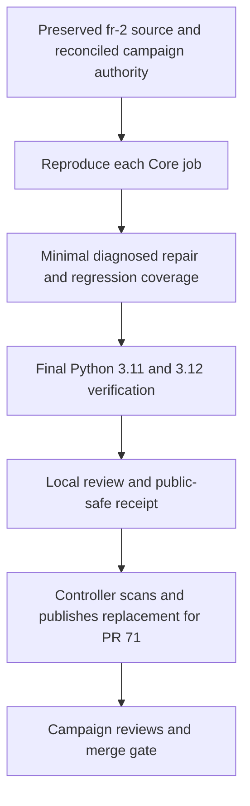

# Repair fr-2 Core CI for PR 71 - Plan

## Goal Capsule

- **Objective:** Operators retain the content-free campaign readiness summary, and its replacement for PR #71 passes the repository's required verification on Python 3.11 and 3.12.
- **Means:** Preserve the local fr-2 baseline, reproduce the failing Core steps, and repair their smallest demonstrated causes (KTD1–KTD3).
- **Scope:** Mandate item `fr-5`, classified as an expansion, on `drawdown/fr-5` only. Deliver one replacement PR containing fr-2 and its CI repair.
- **Authority:** The controller's fr-5 dispatch and standing rules; `CLAUDE.md`; the three September 30 plans cited below. Chief authority is `docs/plans/2026-10-26-0705-feat-codex-drawdown-campaign-plan.md` in the chief repository, limited to its Goal Capsule and campaign R11, R15, R16, R17, R19, and R20.
- **Authority availability:** The chief plan and `ops/drawdown/mandates/_common.md` are absent from this sandbox. Their text has not been independently verified. Controller reconciliation of those sections is a build-dispatch prerequisite, not a new Damien decision.
- **Execution profile:** This stage writes and commits the plan only. The later build runs `lfg` on this plan through implementation, simplification, review, verification, and local commits. The controller scans, pushes, and creates the replacement PR; the campaign gate owns required reviews and merging.
- **Stop conditions:** R5–R7 govern prohibited actions. An unavailable required check remains incomplete; it cannot be converted into a passing check or omitted test.

---

## Product Contract

### Summary

Repair the Core failures reported for PR #71 while retaining fr-2's existing command, schema, output semantics, and tests. Supply complete local CI evidence for both supported runtimes and a controller handoff that explicitly links the replacement PR to #71.

### Problem Frame

The controller reports failures in both Core jobs on PR #71. The original fr-2 build receipt records 74 readiness tests and 91 selected tests on each runtime, but states that frozen dependency installation, Ruff, mypy, and broader Core verification were unavailable. Those selected results do not establish that either CI job passes.

### Requirements

These R-IDs are local to this plan. **Campaign R17** concerns branch isolation; **U10 R17** and **retrieval R11** concern evaluation verdicts and adoption.

**Preserve the delivered feature**

- R1. Retain the complete fr-2 history and behavior on `drawdown/fr-5`; the local baseline is `e19f385947d6dcc4a4c595cf02a1b5292c676857`.
- R2. Preserve the readiness contract in `docs/plans/2026-10-26-1051-feat-fr-2-campaign-readiness-plan.md`, especially its R1–R6, and the interface documented in `eval/README.md`.
- R3. Add focused offline regression coverage for the repair while retaining every existing test and assertion; do not introduce skips, narrower collection, weaker validators, or broad lint/type exclusions.

**Verification and delivery**

- R4. Both Core jobs must pass locally under the commands in `.github/workflows/ci.yml`, including the complete default suite on each runtime and every non-test verification step.
- R5. Do not invoke live providers, spend, open prohibited credential files or protected evaluation inputs, alter security settings, send messages in Damien's voice, delete unbacked data, or force-push.
- R6. Preserve all protected and frozen input bytes, checkpoints, receipts, app pins, U10 R17, and retrieval R11; introduce no migration, data rewrite, package release, or outside service.
- R7. Keep fr-5 as one expansion on one branch, committed locally without adding a remote or finding credentials; the controller publishes a new PR that explicitly supersedes #71.
- R8. Publication artifacts contain only public-safe diagnostics and repo-relative paths; distinguish local verification from remote CI, publication scanning, and actual PR supersession.

### Key Decisions

- **Guarded expansion delivery** (session-settled: user-directed — chosen over holding expansions for Damien's review: the campaign assigns publication and merge checks to its controller). Governs R7, R8.
- **Preserve the assigned item boundary** (session-settled: user-directed — chosen over speculative features after useful work runs out: the campaign directs durable hygiene instead). Governs R1, R2, R6, R7.

### Scope Boundaries

The repair targets the readiness launcher/module, its tests, and a new verification receipt. Existing workflow configuration, dependency versions, test selection, and usage semantics are the acceptance baseline. Change another file only when a reproduced failure makes it necessary to satisfy R4, and record that causal link before extending the patch.

No new readiness capability, validation bypass, CI retry mechanism, provider fallback, or dependency audit is planned. None is supported by the current failure evidence. Reconsider only if a reproduced failure requires a change within this item's CI repair.

No frontend change is proposed. If a frontend change becomes necessary, campaign R15/R16 require a Playwright screenshot committed under `docs/plans/evidence/` and a final `SCREENSHOT:` path.

#### Deferred to Follow-Up Work

Replay/finalization, adoption scorecards, persona UAT campaigns, and general worktree cleanup remain separate mandate items.

---

## Planning Contract

### Reverified Starting State

Read-only inspection on 2026-11-08 found `drawdown/fr-5` and `drawdown/fr-2` already at the same commit, `e19f385947d6dcc4a4c595cf02a1b5292c676857`, with identical trees. The six fr-2 commits are retained: `abf14ce`, `cfb913e`, `a541285`, `57f50fa`, `9f14cd6`, and `e19f385`. Their build receipt names `drawdown/fr-2` and the original plan.

The only other local branch is `main` at `0a09f2c15b97458ab46429c1290e249578cbde73`. No remote is configured. This plan existed as an untracked draft; there were no tracked changes. This planning pass updates that draft in place and requires no branch reconstruction or history change.

This establishes the available local baseline, not PR #71's current remote head. No remote query, tests, lint, type checks, builds, provider runs, or protected-input reads were performed during planning.

### Source Findings

- `eval/check_campaign_readiness.py` sets `sys.dont_write_bytecode` before importing the readiness module. Its delayed import lacks the `E402` annotation present in `eval/run_comparison_pilot.py` and `eval/run_comparison_pilot_repair.py`. Because Ruff's E rules are enabled, this is a concrete reproduction target common to both jobs, not a confirmed CI diagnosis.
- The launcher suppresses bytecode before importing `main`. The module then parses arguments, reads only the supplied snapshot for summary generation, and writes stdout or fixed stderr diagnostics. `--help` bypasses snapshot loading. Existing tests exercise exit 0 for summaries, exit 2 for invalid input, and exit 1 for output failures; these are source observations, not new execution results.
- The readiness module imports only the standard library. Its tests scope global patches with `monkeypatch.context()` and run launcher cases in subprocesses. The copied-launcher test uses an isolated interpreter without `-B` and compares every file's bytes before and after; it currently covers JSON only. No test-state leak was established by inspection.
- `.github/workflows/ci.yml` installs only the `dev` extra. `pyproject.toml` limits default mypy to `src/folio_resolve` and excludes the separate `embedding_integration` marker from the default suite. The lock records pytest 9.1.1, pytest-asyncio 1.4.0, Ruff 0.15.21, and mypy 2.3.0.
- The full suite has committed-input reads beyond generated fixtures. `tests/test_eval_campaign_report.py` reads committed corpus and no-match rows during collection, and `test_pinned_manifest_digest_matches_committed_manifest` reads a committed firm-surface manifest. Its temporary-gold fixture does not intercept these reads. Their classification under R5 must be resolved from controller authority before full collection; being tracked in Git does not establish permission. No input contents were opened during planning.

### Key Technical Decisions

- KTD1. **Diagnose against the retained baseline.** Compare each failing command with the local fr-2 tree and record its exact failing step before selecting a repair. Controller-supplied PR #71 logs can corroborate the diagnosis; local reproduction remains required (R1, R4).
- KTD2. **Keep startup ordering intact.** Bytecode suppression must precede project imports. If Ruff confirms E402, use the same documented, import-local exception as the existing comparison launcher. Do not move the import above the guard or disable E402 globally (R2, R3).
- KTD3. **Keep fixtures and refusal paths real.** Extend `tests/test_eval_campaign_readiness.py` using fabricated snapshots and copied-launcher subprocesses. Preserve its independent inventories, fixed diagnostics, no-artifact assertions, and forbidden-I/O checks. Do not import producer modules or reuse private-data fixtures (R2, R3, R5).
- KTD4. **Run the unchanged matrix in separate managed environments.** Select Python 3.11 and 3.12 explicitly and keep `UV_MANAGED_PYTHON=true`. Record the project and installed-wheel interpreter versions for each job; both must match that matrix entry. Preserve per-version results before the next job overwrites `test-results/core.xml`. Each wheel smoke uses its own temporary environment outside the checkout (R4, R8).
- KTD5. **Separate repair evidence from campaign evidence.** Create `docs/plans/evidence/fr-5-ci-repair-receipt.md`; retain the original fr-2 receipt unchanged. A unit-test pass does not prove publication-scan acceptance, campaign completion, or remote PR status (R6, R8).
- KTD6. **Resolve test-input scope before collection.** Use test source and controller context to establish whether the known committed-input reads are permitted under R5. Until resolved, continue independent lint, typing, packaging, and fabricated readiness checks. Record full-suite verification as incomplete; never remove tests, replace pinned inputs, or broaden permission by inference (R3–R5).

### High-Level Technical Design

### Assumptions and Dependencies

The local tip is the available evidence of fr-2, but its equality to PR #71's current head is unverified. The controller must compare them before publication, preserve any additional fr-2 commits, and require new verification after any resulting source change. This requires no credential access in the worker.

The exact failing steps and any interpreter-specific differences are build-time unknowns. Do not assume the E402 candidate is the only defect, or that a supplemental readiness-module mypy error explains a Core failure.

The build needs the locked development packages and both managed interpreters available through the sandbox's dependency caches. Cache misses and denied Unix sockets are environment limitations, not permission to weaken tests.

Chief-source reconciliation remains a controller prerequisite for build dispatch. KTD6 separately gates full pytest collection until the controller establishes the permitted input scope or supplies a compliant verification environment. Independent checks and repairs can continue under the reconciled authority. Missing remote logs do not prevent local diagnosis. No new Damien decision is established.

---

## Implementation Units

### U1. Establish the failing Core baseline

**Goal:** Identify the actual failures under both CI runtimes before changing code.

**Requirements:** R1, R4–R8; KTD1, KTD4–KTD6.

**Dependencies:** Controller reconciliation of the chief Goal Capsule and cited R-IDs.

**Files:** Read `.github/workflows/ci.yml`, `pyproject.toml`, `uv.lock`, the three readiness source/test files named in U2, and `docs/plans/evidence/fr-2-build-receipt.md`; start `docs/plans/evidence/fr-5-ci-repair-receipt.md`.

**Approach:**

1. Resolve KTD6 before full-suite collection; retain independent progress when that prerequisite is unavailable.
2. Establish separate environments matching the workflow and execute the Verification Contract against the retained source.
3. Capture all failing steps, including lint after a test failure, without treating a manually continued job as passing. Attribute repository defects separately from missing toolchains, caches, or socket support.

**Test expectation:** No new behavior in this unit; run the existing default suite and CI checks without modifying selection or fixtures.

**Verification:** The receipt identifies the baseline commit, each runtime, failing command and safe diagnostic, plus any unavailable check. The E402 hypothesis is confirmed or rejected by an actual Ruff result.

### U2. Repair demonstrated defects and preserve readiness behavior

**Goal:** Make the diagnosed failure paths pass without changing the summary's contract.

**Requirements:** R1–R6; KTD2, KTD3.

**Dependencies:** U1's reproduced diagnostics.

**Files:** `eval/check_campaign_readiness.py`, `eval/folio_eval/campaign_readiness.py`, and `tests/test_eval_campaign_readiness.py`; `eval/README.md` only if a necessary clarification follows from the repair.

**Approach:** Apply the smallest fixes supported by U1. Follow the existing comparison-launcher import convention for a confirmed E402 finding. Correct additional Ruff or typing defects without changing validation or output values. Any behavioral defect gets a focused failing-before/passing-after regression before its repair; a lint-only repair is demonstrated by the lint diagnostic and unchanged behavioral tests.

**Patterns to follow:** Annotated startup imports in `eval/run_comparison_pilot.py`; temporary copied-launcher tests in `tests/test_eval_campaign_readiness.py`; fixture isolation preserving real validators in `docs/solutions/2026-09-19-synthetic-score-manifest-verification.md`.

**Test scenarios:**

1. Add copied-launcher cases for Markdown output and `--help`, starting with no bytecode artifacts. Invoke an isolated interpreter without `-B` so the launcher's own bytecode guard is exercised; require expected stdout, empty stderr, exit 0, unchanged input/source bytes, and no new files. Retain the existing JSON case and every original assertion.
2. For each behavioral repair beyond lint, add the reproduced input and its neighboring rejection case, checking the documented exit code and fixed diagnostic without exposing supplied values.
3. Re-run the existing actual broken-pipe and closed-stream cases; output errors still return 1, and invalid input still returns 2 without a partial summary.
4. Re-run the original inventory, determinism, adverse-attestation, and forbidden-I/O tests; complete attestations still grant neither verification nor authorization.

The subprocess tests protect import ordering and process-exit behavior; they do not establish type correctness, live campaign readiness, or packaging acceptance.

**Verification:** All original readiness cases and new cases pass on both runtimes, reproduced lint failures are gone, and the diff retains the R2 contract. No frozen expectation or source digest is refreshed to obtain a pass.

### U3. Complete verification and prepare the replacement-PR handoff

**Goal:** Deliver reviewed local commits with complete Core evidence and an explicit publication dependency.

**Requirements:** R1–R8; KTD4, KTD5.

**Dependencies:** U2.

**Files:** `docs/plans/evidence/fr-5-ci-repair-receipt.md`; retain Codex review prompt/verdict artifacts under `docs/plans/evidence/` only when their contents are confirmed public-safe, otherwise retain them with the controller and publish their artifact names and verdict only.

**Approach:** Run the full Verification Contract after the final repair. Record separate interpreter and command results, compare the final diff against fr-2, and retain the review receipt required by `CLAUDE.md`. The controller verifies the remote fr-2 head, completes publication scans and campaign reviews, and records the replacement PR's explicit supersession of #71.

**Test expectation:** No new product behavior; all required final checks run on the same implementation. Any subsequent source change invalidates affected evidence and requires re-verification.

**Verification:** Both local matrix entries have complete passing evidence, the review has no unresolved blocking findings, and the controller receives the branch, plan path, receipt, and remaining publication obligations. Do not claim PR #71 is superseded until the replacement PR exists.

---

## Verification Contract

The following are build-stage checks, not results established by this plan. Execute the exact workflow commands in each managed runtime; preserve the first job's artifacts before running the second. Use the existing lock and sandbox cache without borrowing another interpreter's site-packages.

| Check | Command or workflow block | Python | Acceptance |
|---|---|---|---|
| Frozen development environment | `uv sync --frozen --extra dev` | 3.11 and 3.12 | Successful installation; actual runtime recorded |
| Complete default suite | `uv run --no-sync pytest -ra --junitxml=test-results/core.xml` | 3.11 and 3.12 | No failures or errors; counts and existing skips explained separately |
| Repository lint | `uv run --no-sync ruff check .` | 3.11 and 3.12 | Exit 0 without broad rule suppression |
| Library types | `uv run --no-sync mypy` | 3.11 | Exit 0 with the existing configured scope |
| Wheel build | `uv build --wheel --out-dir "$RUNNER_TEMP/wheel-dist"` | 3.11 and 3.12 | An actual wheel built for each matrix run |
| Installed-wheel smoke | Entire `Verify installed wheel outside checkout` block in `.github/workflows/ci.yml` | 3.11 and 3.12 | Smoke interpreter matches its matrix entry, imports the installed package, and loads nonempty bundled seed rows matching loaded entries |
| Readiness types, supplemental to Core | `uv run --no-sync mypy eval/folio_eval/campaign_readiness.py eval/check_campaign_readiness.py` | 3.11 | Both new fr-2 modules checked explicitly, as requested by its build receipt |

The default suite includes all tests selected by `pyproject.toml`, including UAT and fixture-based evaluation tests. Its existing exclusion of `embedding_integration` remains unchanged. The separate optional model workflow is outside this item; no model download or live measurement is authorized.

An existing packaging-test skip does not replace either mandatory wheel step. A missing dependency, denied socket, or unresolved input restriction is recorded as incomplete, never as a pass. KTD6 must be satisfied before the full suite runs. The original fr-2 receipt's broad-test omission does not create an exception to R4.

The final receipt records the tested source commit, interpreter versions, command exit codes, test counts, failure-to-fix evidence, and review artifact names. Keep raw logs and JUnit output containing machine paths out of public commits; publish only sanitized summaries. Controller publication scans remain distinct from fixture-based leak tests.

---

## Definition of Done

- R1–R8 hold: fr-2 remains intact, targeted repair coverage is additive, and both unchanged Core jobs pass locally with the complete default suite.
- The supplemental readiness type check passes, and U1–U3 have the evidence specified above.
- The final diff contains only the necessary repair, its tests, scoped documentation, and receipts; no abandoned experiment or unrelated cleanup remains.
- The recorded Codex review meets `CLAUDE.md`; required Astra/Fable campaign reviews and the merge gate remain controller responsibilities.
- The controller publishes the replacement PR with an explicit link stating that it supersedes #71. Local commits alone do not satisfy this publication condition.

**Rollback:** Revert only fr-5 repair commits if necessary, preserving the fr-2 history and all evaluation data. No migration, checkpoint repair, or package release is involved.

### Sources

- `CLAUDE.md` — repository review receipt and evaluation boundaries.
- `.github/workflows/ci.yml`, `pyproject.toml`, and `uv.lock` — exact Core commands, matrix, selection, and dependency baseline.
- `docs/plans/2026-10-26-1051-feat-fr-2-campaign-readiness-plan.md` and `docs/plans/evidence/fr-2-build-receipt.md` — feature contract and historical verification limits.
- `docs/plans/2026-09-30-u10-finalization-recovery-plan.md`, `docs/plans/2026-09-30-retrieval-loss-live-completion-plan.md`, and `docs/plans/2026-09-30-downstream-evidence-gated-adoption-plan.md` — protected campaign and adoption responsibilities.
- `docs/plans/2026-09-19-0853-feat-ci-embedding-reliability-plan.md`, `eval/README.md`, and `eval/synthetic/README.md` — Core isolation and the distinction between private inputs and immutable generated fixtures.
- `docs/solutions/2026-09-04-u9-iteration-traps.md` and the KTD12/U9 owner amendments in `docs/plans/2026-08-16-001-feat-synthetic-benchmark-f1-campaign-plan.md` — unchanged stop-rule boundaries.
- `docs/solutions/2026-09-07-review-gate-catches-self-inflicted-regressions.md` and `docs/solutions/2026-09-30-frozen-evidence-blocks-library-edits.md` — refusal coverage, publication evidence, and frozen-artifact preservation.
