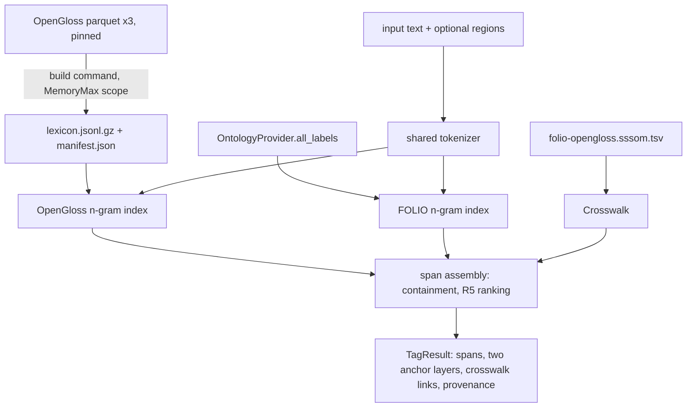

# OpenGloss and FOLIO Span Tagging - Plan

## Goal Capsule

- **Objective:** a consumer such as lexplicit hands folio-resolve a piece of legal text and gets back every vocabulary-bearing span tagged with its FOLIO concepts and its OpenGloss word senses, with phrases ranked above the words inside them, and the same input always yields the same output, stamped with the exact data versions that produced it.
- **Means:** a new opt-in `folio_resolve.spans` package: a compiled OpenGloss lexicon, one token n-gram index shared by both layers, an SSSOM crosswalk reader, and a span tagger that assembles them (KTD1-KTD6).
- **Product authority:** Damien Riehl, through the upstream Product Contract (lexplicit `docs/plans/2026-11-08-1017-feat-opengloss-folio-anchoring-plan.md`, R6, R7, R10). This plan adds no product scope.
- **Execution profile:** one PR, cut from `main` on branch `feat/opengloss-span-tagging`, released as `v0.5.0`. Additive only: no existing module's behavior changes.
- **Stop conditions:** stop and report if the real-data index cannot meet the memory or load-time budget in the Verification Contract, or if the FOLIO crosswalk format diverges from the contract in KTD5.
- **Who finishes:** the executing session reviews (Codex review receipt per `AGENTS.md`), merges, tags `v0.5.0`, and messages the lexplicit session with the tag.

---

## Product Contract

### Summary

folio-resolve gains a span-tagging layer. It finds every span of the input, from one word to a long phrase, whose text matches a FOLIO label or an OpenGloss headword. It records those matches as two separate annotation layers, links each phrase to the words it contains, ranks a phrase with its own meaning above its words, and attaches typed FOLIO-to-OpenGloss crosswalk links from the FOLIO repository's SSSOM mapping set.

### Problem Frame

lexplicit's encoders coin divergent names for the same fact because nothing ties a vocabulary entry to the concept it names (see origin: Problem Frame). lexplicit pins folio-resolve, so the anchors it needs (origin R9, R11, R12) must come from here first (origin Dependencies: release order). folio-resolve today matches FOLIO labels only, through an Aho-Corasick ruler tuned for document annotation, and knows nothing of OpenGloss.

### Key Decisions

Carried from the origin Product Contract. The normative text lives on the governed requirements.

- **Two layers, never merged.** FOLIO and OpenGloss annotations stay separate and link only through the typed crosswalk. Governs R2, R5. (session-settled: user-directed — chosen over merging the two ID sets: merging loses signal)
- **The crosswalk lives in the FOLIO repository; folio-resolve consumes it.** Governs R5. (session-settled: user-directed — chosen over hosting it in folio-resolve or its own repository: it travels with FOLIO releases)
- **Deterministic, pinned, on CPU; every result names its data versions.** Governs R1, R6. (session-settled: user-directed — chosen over model-based tagging: a pinned lookup is reproducible)
- **A claim is never a fact.** Every annotation records its source and method. Governs R6. (session-settled: user-directed — chosen over recording resolutions as settled facts)
- **Use the CC BY 4.0 datasets, not opengloss-rs code.** Governs R7. (session-settled: user-directed — chosen over depending on opengloss-rs before its author adds a LICENSE file)
- **Pinned upstreams upgrade automatically with a receipt.** The rebuild is a deterministic command a heartbeat can run; scheduling it belongs to the heartbeat owner. Governs R8. (session-settled: user-directed — chosen over asking before every upgrade)

### Requirements

**Tagging (origin R6, R10)**

- R1. Tagging text twice with the same inputs and pinned data yields byte-identical serialized output.
- R2. Every span whose normalized tokens match a FOLIO label or an OpenGloss headword is tagged, at every length, as a FOLIO hit, an OpenGloss hit, or both, each in its own layer.
- R3. Each span lists the tagged spans it contains and the tagged spans that contain it.
- R4. Spans made only of function words (determiners, pronouns, prepositions, conjunctions, and the existing ruler stopwords) are not tagged; a caller may restrict tagging to given character regions (origin R10: vocabulary entries and the sentences they cite).

**Ranking (origin R7)**

- R5. Within a layer, a span that has its own anchor and is contained by no anchored span of that layer ranks `primary`; a contained span ranks `fallback` and names the span that outranks it. Fallback anchors stay in the output.

**Crosswalk and provenance (origin R6, Key Decisions)**

- R6. Each crosswalk link joins a FOLIO hit and an OpenGloss hit on the same span or on a span it contains, and carries the mapping's predicate, confidence, justification, and the mapping set's id and version.
- R7. Every result records the OpenGloss dataset id and revision, the lexicon artifact digest, the FOLIO release identity, the crosswalk set id and version when used, and the folio-resolve and tagger versions. Every anchor records its match method and, for OpenGloss, the sense's `source` and `tier`.
- R8. The OpenGloss lexicon rebuilds from the pinned parquet files with one command, verifies their sha256 values, and writes a manifest a heartbeat can diff.

**Compatibility**

- R9. Existing public APIs and their outputs do not change; the new layer installs and imports only when used.

### Acceptance Examples

- AE1. **Covers R2, R5.** Given "The tenant acted in good faith.", when tagged with the real lexicon, "good faith" carries its OpenGloss phrase senses and ranks `primary`; "good" and "faith" carry their senses, rank `fallback`, and name the "good faith" span (origin AE6).
- AE2. **Covers R3, R6.** Given "breach of contract" with a FOLIO hit on the phrase and a crosswalk row `FOLIO:<breach-of-contract> skos:broadMatch OGS:breach:noun:0`, the result links the phrase's FOLIO hit to the `breach:noun:0` sense on the contained "breach" span.
- AE3. **Covers R4.** Given "of the", nothing is tagged.
- AE4. **Covers R1, R7.** Given the same text, lexicon, FOLIO labels, and crosswalk, two runs serialize identically, and the provenance names revision `c64e480015b8c84f9d08469d4dfd64a7a8fb89bd`.

### Scope Boundaries

- **Deferred for later (origin):** candidate tagging adoption by folio-enrich, folio-mapper, or folio-insights; full R16 resolution of every undefined term; tagging every token.
- **Outside this product's identity (origin):** evidentiary confidence; human resolution of ambiguity.
- **Not built, considered:**
  - Sense disambiguation (choosing one sense per span). The spike measured sense ambiguity as rarely outcome-changing; every sense is returned with its gloss. Revisit if lexplicit's R23 sense-resolution accuracy shows a need.
  - Rewriting `FOLIOEntityRuler` onto the new index. It would change consumer-visible annotation output, which R9 forbids; the new index reuses the ruler's pattern filters instead (KTD2).
  - Lemmatizing input with spaCy at tag time. It breaks the CPU-only, zero-heavy-dependency runtime; KTD3 covers plural and hyphen variants deterministically.

### Deferred to Follow-Up Work

- **Heartbeat scheduling (origin R20):** lexplicit's heartbeat job (origin A5) calls U1's rebuild and check commands; folio-resolve ships the commands, not the schedule.
- **Lexicon distribution:** publishing a prebuilt lexicon as a release asset, if consumers want to skip the build.

### Sources

- Origin plan, spike, and brainstorm record: lexplicit `docs/plans/2026-11-08-1017-feat-opengloss-folio-anchoring-plan.md`, `docs/research/2026-11-08-opengloss-anchoring-spike.md` (branch `wip/opengloss-anchoring`), and `docs/handoffs/2026-11-08-opengloss-anchoring-brainstorm-state.md` (branch `docs/lean-for-law-plan`).
- OpenGloss v2.4 senses, `mjbommar/opengloss-v2.4-senses@c64e480015b8c84f9d08469d4dfd64a7a8fb89bd`, CC BY 4.0. Pinned sha256 values: lexplicit `trusted/opengloss/build_extract.py`. Measured on 2026-11-08: 300,787 senses, 160,724 lowercase headwords, 72,815 of them multi-word ("good faith", "breach of contract", "real property", "security deposit" present; "finance charge" absent). Columns include `source` (some rows `wordnet-3.0`) and `tier`.
- Crosswalk contract, agreed with the FOLIO session on 2026-11-08: folio repo `mappings/opengloss/folio-opengloss.sssom.tsv` (branch `feat/opengloss-mapping`, unmerged at plan time).

---

## Planning Contract

### Key Technical Decisions

- KTD1. **Compile OpenGloss into a small stdlib-readable lexicon at build time; never read parquet at tag time.** `pyarrow` enters only as a new optional extra `opengloss` for the build command. The artifact keeps `sense_id`, `headword`, `pos`, `sense_index`, `domain`, `tier`, `source`, and `gloss`, written as sorted, gzip-compressed JSON lines with a zero mtime so the bytes are reproducible, plus a manifest recording the dataset, revision, source-file sha256 values, row count, and artifact sha256. The artifact is not committed; a small extract from the pinned revision serves as the test fixture, with attribution. Rationale: consumers keep a pure-Python runtime and the 640 MB parquet stays out of every process but the build.
- KTD2. **One token n-gram index serves both layers, replacing nothing.** Labels and headwords are keyed by their normalized token tuples, and tagging looks up every n-gram up to the longest key length. Both layers share the tokenizer, so their spans align exactly, which makes containment links and crosswalk joins exact comparisons. The FOLIO layer reads `OntologyProvider.all_labels()` and reuses `entity_ruler`'s `MIN_PATTERN_LENGTH`, `_STOPWORDS`, and label-type confidences. Rationale: the pure-Python Aho-Corasick trie would hold one node per character across 160k headwords, while an n-gram dict holds one entry per headword. Its overlap resolution also drops partial overlaps, which R2 must keep.
- KTD3. **Normalization is fixed and recorded per match.** Case-folding and NFKC, hyphens and whitespace treated as token separators (so "fully-indexed" matches "fully indexed"), and curly apostrophes folded. When the exact key misses, one fallback strips a final-token English plural (`ies`→`y`, `es`, `s`) for nouns only; its anchors carry `match_method: "plural"` and lower confidence than `"exact"`. Rationale: OpenGloss headwords are lemmas and statutes say "tenants"; spaCy at tag time is ruled out (Scope Boundaries).
- KTD4. **Function-word filtering uses the lexicon's own part-of-speech data plus the ruler stopwords.** An OpenGloss single-token span is dropped when every sense of it is a determiner, pronoun, preposition, conjunction, interjection, or numeral, or when the token is in `_STOPWORDS`. A multi-token span survives when at least one token is a content word. Rationale: R4 needs a deterministic rule, and the data already carries part of speech.
- KTD5. **Read the SSSOM TSV with the stdlib `csv` module and the `#`-prefixed YAML header with a minimal parser for the keys used.** CURIEs expand through the file's `curie_map`, never a hard-coded namespace; the `OGS:` prefix maps back to the raw `sense_id`. Unknown columns are ignored, and a missing required column fails loudly naming it. Required: `subject_id`, `predicate_id`, `object_id`, `mapping_justification`; `confidence` optional. Rationale: no YAML or SSSOM dependency for a fixed, sorted format; the header keys used are flat scalars plus one flat map.
- KTD6. **Determinism excludes wall-clock time.** The result carries no timestamp unless the caller passes `tagged_on`, which is recorded verbatim. Spans sort by `(start, -end)`, anchors by id, links by `(span, subject, predicate, object)`. JSON serialization uses sorted keys. Rationale: R1, and a claim's research date belongs to the consumer that makes the claim.
- KTD7. **The FOLIO release identity is supplied, then verified by content.** The tagger takes a caller-supplied `folio_release` string (such as the FOLIO.owl git commit) and also records a sha256 over the sorted label index it actually used. Rationale: `OntologyProvider` exposes no version, and a content digest proves what was matched even when the caller's string is wrong.

### High-Level Technical Design

Build time and tag time are separate processes; only the build reads parquet.



Span assembly, directional:

```text
spans = union of matched (start, end) over both layers
for each span: contains = spans strictly inside it; contained_by = the inverse
for each layer: rank primary if anchored here and no anchored container in this layer, else fallback(outranked_by = nearest anchored container)
links = crosswalk rows (folio iri on span P, sense on P or any span P contains)
```

### Output Structure

```text
src/folio_resolve/spans/
  __init__.py      public API (SpanTagger, TagResult, loaders)
  tokenize.py      shared tokenizer and normalization (KTD3)
  index.py         token n-gram index (KTD2)
  lexicon.py       OpenGloss lexicon loader, builder, CLI (KTD1)
  crosswalk.py     SSSOM reader (KTD5)
  tagger.py        span assembly, ranking, provenance (KTD4, KTD6, KTD7)
  models.py        pydantic result models
tests/spans/
  fixtures/        small OpenGloss extract, synthetic SSSOM file
```

### Assumptions

- The SSSOM file will match the contract the FOLIO session confirmed on 2026-11-08. Until it merges, tests run on a synthetic file in that shape. If the real file diverges, U3 adapts and the plan's stop condition applies only to a structural change.
- Senses with `source: wordnet-3.0` stay in the lexicon, with their source recorded on every anchor. The OpenGloss v2.4 dataset as a whole carries CC BY 4.0. WordNet's own license is permissive and asks for attribution, so `THIRD-PARTY.md` names it too. A consumer that wants OpenGloss-native senses only can filter on `source`.
- Version `0.5.0` is the right bump: a minor release for an additive feature under the current 0.x line.

### Risks

| Risk | Mitigation |
|---|---|
| Real-data index too large or slow in pure Python | U5 measures peak RSS and load time under a MemoryMax scope against the budget below; the stop condition applies if it fails |
| New library files change `library_source_sha256` and trip frozen benchmark receipts | `benchmarks/evidence_replay.py` replays instead of comparing source digests (`docs/solutions/2026-09-30-frozen-evidence-blocks-library-edits.md`); the full core suite must stay green |
| Common phrases link unrelated facts (spike: about 1% alias precision) | Out of this repo's control; anchors are evidence, and lexplicit's R13 keeps them from renaming anything |
| Plural fallback over-matches ("bus" → "bu") | Nouns only, final token only, applied only on an exact miss, and labeled `plural` so consumers can discount it |

---

## Implementation Units

### U1. OpenGloss lexicon build and loader

- **Goal:** compile the pinned parquet into the reproducible lexicon artifact and load it with the stdlib.
- **Requirements:** R7, R8, R9; KTD1.
- **Dependencies:** none.
- **Files:** `src/folio_resolve/spans/lexicon.py`, `src/folio_resolve/spans/__init__.py`, `pyproject.toml` (new `opengloss` extra pinning `pyarrow`), `uv.lock`, `THIRD-PARTY.md`, `tests/spans/test_lexicon.py`, `tests/spans/fixtures/opengloss-mini.jsonl.gz`, `tests/spans/fixtures/opengloss-mini.manifest.json`.
- **Approach:**
  1. The builder takes the three parquet paths, verifies each sha256 against the pinned values before reading, reads only the kept columns, sorts rows by `(headword.lower(), pos, sense_index, sense_id)`, and writes the artifact and manifest.
  2. A `python -m folio_resolve.spans.lexicon` entry point offers `build` and `verify`. `verify` re-hashes an artifact against its manifest.
  3. The loader reads the artifact, checks its digest against the manifest, and exposes senses grouped by normalized headword.
  4. A `headwords` filter on the builder produces the test fixture: about 20 headwords including "good faith", "good", "faith", "breach", "contract", "tenant", "property", and a pure function word.
  5. `THIRD-PARTY.md` gains `pyarrow` (Apache-2.0) and the OpenGloss CC BY 4.0 attribution, worded as in lexplicit `trusted/opengloss/README.md`, plus WordNet 3.0.
- **Patterns to follow:** lexplicit `trusted/opengloss/build_extract.py` for column choice and sorting. `src/folio_resolve/lemma.py` for an optional-dependency import guard with a clear error that names the extra.
- **Test scenarios:**
  - Building the fixture twice yields byte-identical artifacts and manifests.
  - A parquet file whose sha256 differs from the pin fails before any row is read, naming the file.
  - Loading an artifact whose bytes differ from its manifest digest fails, naming both digests.
  - The loader returns all senses of "good faith" in `sense_index` order, each with `source` and `tier`.
  - Importing `folio_resolve` and `folio_resolve.spans` succeeds without `pyarrow` installed. Only `build` raises the missing-extra error.
- **Verification:** the fixture builds reproducibly from the real parquet, and the loader passes on it with no `pyarrow`.

### U2. Shared tokenizer and n-gram index

- **Goal:** one deterministic tokenizer and a token-tuple index that returns every matching span, overlaps included.
- **Requirements:** R1, R2, R4; KTD2, KTD3, KTD4.
- **Dependencies:** none.
- **Files:** `src/folio_resolve/spans/tokenize.py`, `src/folio_resolve/spans/index.py`, `tests/spans/test_tokenize.py`, `tests/spans/test_index.py`.
- **Approach:**
  1. The tokenizer emits word tokens with character offsets into the original text and applies KTD3 normalization to a parallel key.
  2. The index maps a normalized token tuple to its payloads and records the longest key length. A lookup walks every start token and every length up to that maximum. Regions restrict the start and end tokens to those inside a region.
  3. On an exact miss, the plural fallback runs as KTD3 defines. The function-word filter runs as KTD4 defines.
- **Patterns to follow:** `src/folio_resolve/matching/aho_corasick.py` for word-boundary semantics. `src/folio_resolve/entity_ruler.py` for the stopword list and minimum length.
- **Test scenarios:**
  - "real property tax" with keys "real property" and "property tax" returns both partially overlapping spans plus "property".
  - "fully-indexed rate" matches the key "fully indexed rate" and the reverse.
  - "Tenants" matches "tenant" with method `plural`. "tenant" matches with method `exact`.
  - A text with curly apostrophes and mixed case matches its straight-apostrophe, lowercase key, and offsets point into the original text.
  - With a region covering only the second sentence, no span from the first sentence is returned.
  - Covers AE3. "of the" returns nothing.
  - Empty text and text with no matches return an empty list.
- **Verification:** all offsets slice the original text to the reported surface, and results are stable across runs.

### U3. SSSOM crosswalk reader

- **Goal:** load the FOLIO-to-OpenGloss mapping set into lookups keyed by FOLIO IRI.
- **Requirements:** R6, R7; KTD5.
- **Dependencies:** none.
- **Files:** `src/folio_resolve/spans/crosswalk.py`, `tests/spans/test_crosswalk.py`, `tests/spans/fixtures/folio-opengloss-mini.sssom.tsv`.
- **Approach:**
  1. Parse the `#` header for `curie_map`, `mapping_set_id`, `mapping_set_version`, `license`, and the source versions.
  2. Read rows with `csv.DictReader` over tab-delimited lines, expand `subject_id` through `curie_map` to a full FOLIO IRI, and reduce `object_id` to the raw sense id through the `OGS` prefix's expansion.
  3. Keep `predicate_id`, `confidence`, and `mapping_justification` on each link.
- **Patterns to follow:** `src/folio_resolve/blocklist.py` for loading a data file into an immutable lookup.
- **Test scenarios:**
  - The fixture loads, and the "breach of contract" IRI maps to its exactMatch and broadMatch links with confidences.
  - An `OGS:` expansion different from the fixture's still yields the same raw sense ids, because the expansion comes from `curie_map`.
  - A file missing `predicate_id` fails, naming the column. A file with an extra column loads.
  - A row whose predicate is not a SKOS mapping property fails, naming the row number.
  - Set id and version from the header appear on every link.
- **Verification:** the reader loads the FOLIO session's real file once it exists, recorded in U5.

### U4. Span tagger

- **Goal:** assemble both layers, containment, ranking, crosswalk links, and provenance into one deterministic result.
- **Requirements:** R1-R7, R9; KTD2, KTD4, KTD6, KTD7.
- **Dependencies:** U1, U2, U3.
- **Files:** `src/folio_resolve/spans/tagger.py`, `src/folio_resolve/spans/models.py`, `src/folio_resolve/spans/__init__.py`, `tests/spans/test_tagger.py`.
- **Approach:**
  1. `SpanTagger` takes an optional `OntologyProvider`, an optional lexicon, an optional crosswalk, and `folio_release`. At least one layer is required. Indexes build once at construction.
  2. `tag(text, regions=None, tagged_on=None)` runs both indexes, unions their spans, computes containment, ranks each layer per R5, joins crosswalk links per R6, and fills provenance per R7.
  3. Pydantic models carry span ids derived from offsets (`s{start}-{end}`), so ids are stable and readable. `TagResult` offers deterministic JSON per KTD6.
  4. Export `SpanTagger` and `TagResult` from `folio_resolve.spans` only. The top-level `folio_resolve` namespace stays unchanged (R9).
- **Patterns to follow:** `src/folio_resolve/annotate/models.py` for pydantic model style. `src/folio_resolve/pipeline.py` for build-once construction.
- **Test scenarios:**
  - Covers AE1. With the fixture lexicon, "acted in good faith" ranks "good faith" `primary` and "good" and "faith" `fallback`, each naming `s{good faith span}`.
  - Covers AE2. With an in-memory FOLIO concept "Breach of Contract" and the fixture crosswalk, the result links the phrase's FOLIO hit to `breach:noun:0` on the contained "breach" span, with predicate `skos:broadMatch`.
  - A span anchored only in OpenGloss and contained in a span anchored only in FOLIO stays `primary` in the OpenGloss layer, because ranking is per layer.
  - A FOLIO-only tagger records no OpenGloss provenance and produces no links, and the reverse holds for an OpenGloss-only tagger.
  - Covers AE4. Two runs on the same inputs serialize identically, and provenance names the fixture's revision, the lexicon digest, the label-index digest, and the crosswalk set version.
  - `tagged_on` appears verbatim when passed and is absent otherwise.
  - Constructing with no layer fails with a clear error.
- **Verification:** the tagger runs on the fixtures with only core dependencies installed.

### U5. Real-data check, documentation, and release

- **Goal:** prove the tagger on the full pinned lexicon and real FOLIO labels within budget, document it, and release `v0.5.0`.
- **Requirements:** R1, R7, R8, R9; Success Criteria.
- **Dependencies:** U4.
- **Files:** `benchmarks/span_tagging_real_data.py`, `docs/benchmarks/span-tagging-real-data.md`, `README.md`, `pyproject.toml` (version), `tests/spans/test_real_data.py` (skipped unless the artifact path is set).
- **Approach:**
  1. Build the full lexicon from `~/.local/share/lexplicit/artifacts/opengloss/v2.4-c64e480/` inside a systemd user scope with a MemoryMax.
  2. Time construction and tagging on the spike's tiers' sentences and FOLIO.owl labels, record peak RSS, and run AE1 on real data. Record the receipt in `docs/benchmarks/span-tagging-real-data.md`, with repo-relative or symbolic paths only.
  3. Load the FOLIO session's SSSOM file if it has landed, and record the result; otherwise record that the fixture stood in.
  4. Add a README section with usage, the provenance fields, and the attribution. Bump the version.
- **Patterns to follow:** `docs/benchmarks/embedding-baseline.md` for receipt shape.
- **Test scenarios:**
  - Covers AE1. On the real lexicon, "good faith" ranks `primary` over "good" and "faith".
  - On real data, "property" tags OpenGloss senses that carry no legal sense, matching the spike's finding. The test asserts presence and records the gap, not a fix.
  - Test expectation for docs and the version bump: none, as they are documentation and packaging.
- **Verification:** the receipt shows the budget met, and the full core suite, ruff, and mypy pass.

---

## Verification Contract

| Gate | Command | Applies to |
|---|---|---|
| Core tests | `uv run pytest -ra` | every unit, and the full suite before the PR |
| Lint | `uv run ruff check .` | every unit |
| Types | `uv run mypy` | every unit (strict, `src/folio_resolve`) |
| No-extra import | install without the `opengloss` extra, then import `folio_resolve.spans` and tag with fixtures | U1, U4 |
| Real-data budget | U5 script inside `systemd-run --user --scope -p MemoryMax=4G` | U5 |
| Review | recorded Codex review, prompt and verdict retained as artifacts, receipt line per `AGENTS.md` | PR |

Real-data budget: index construction under 60 s, peak RSS under 3 GiB, and tagging throughput reported. Any budget failure is a stop condition, not a reason to relax the budget.

## Definition of Done

- All five units are merged in one PR, and core CI is green on Python 3.11 and 3.12.
- Every AE1-AE4 scenario passes, AE1 on the fixture and on real data.
- Existing tests pass unchanged, including the frozen-evidence replay suites (R9).
- The Codex review receipt line is recorded, with verdict `merge`.
- `v0.5.0` is tagged and released, and the lexplicit session has been told the tag.
- No abandoned-attempt code, scratch files, or machine-local paths are left in the diff.
